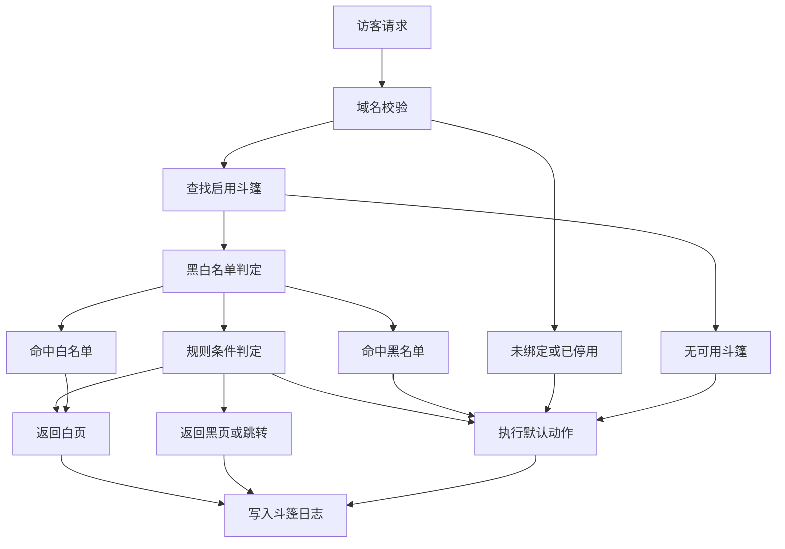

# 斗篷系统 MVP PRD

## 1. 文档信息

| 项目 | 内容 |
| --- | --- |
| 产品名称 | 斗篷系统 |
| 文档版本 | v0.2 |
| 适用阶段 | MVP 需求设计，以及三方斗篷网关重构 |
| 业务场景 | 广告投放 / 落地页访问分流 / 终端网站来源归因 |
| 产品形态 | 多商户 SaaS 管理后台 + 三方斗篷网关 + 访问判定服务 + API 能力 |

## 2. 产品概述

斗篷系统用于广告投放和落地页访问场景。商户将投放域名绑定到系统，在后台配置斗篷策略、黑白名单和目标页面。访客访问绑定域名时，系统根据 IP、地区、设备、User-Agent、Referer、访问频次、黑白名单等条件进行判定，并返回白页、黑页、跳转页或拦截页。

v0.2 起，系统同时作为三方斗篷网关：商户的终端网站继续使用自己的域名，由网关负责识别来源、保存归因并返回判定。接入方式对齐支付网关，包含终端登记、公钥、服务端密钥和服务端调用。网关不承接支付收单。托管跳转（域名解析到网关）保留为可选接入，不再是唯一入口。终端归因的范围、流程和功能清单见第 17 章。

MVP 目标是先交付可运营、可审计、可扩展的基础版本，满足商户自助配置斗篷、查看访问日志，总后台管理商户账号、审计操作、查看平台数据的核心需求。

## 3. 产品目标

- 支持多商户独立使用，商户之间数据隔离。
- 支持商户绑定域名并配置多个斗篷策略。
- 支持基于规则的访问判定，并记录可查询的斗篷日志。
- 支持商户通过 API 创建、查询和管理斗篷。
- 支持总后台管理商户账号、状态、权限和关键数据。
- 支持完整操作日志，便于排查问题和追责。

## 4. MVP 边界

### 4.1 MVP 包含

- 登录、退出、修改密码、基础账号状态控制。
- 商户端：数据看板、域名绑定、斗篷列表、斗篷配置、斗篷日志、API 斗篷、API 斗篷日志、黑白名单、操作日志。
- 总后台：平台数据看板、商户账号管理、商户数据查看、域名与斗篷监管、操作日志、系统配置。
- 访问判定：根据域名和斗篷规则返回对应页面或跳转目标。
- 日志审计：访问日志、API 调用日志、后台操作日志。
- v0.2 网关重构：终端站点、来源归因、回访识别、渠道规则和渠道报表，详见第 17 章。

### 4.2 MVP 暂不包含

- 在线支付、自动续费、发票、复杂套餐计费。
- 自动风控评分、机器学习识别、广告平台自动检测。
- 可视化落地页编辑器。
- 多语言后台。
- 短信、邮件、Webhook 告警。
- 批量导入导出高级能力。
- 跨浏览器设备识别、浏览器指纹、用 IP 充当设备号。
- App 与网站通过设备号打通。
- 支付收单、退款、对账。支付网关仅指接入形态。

## 5. 核心术语

| 术语 | 说明 |
| --- | --- |
| 商户 | 使用斗篷系统的客户主体，拥有独立账号、域名、斗篷和日志数据 |
| 绑定域名 | 接入系统的投放域名，用于承载访问请求 |
| 斗篷 | 一组访问判定规则和命中后的展示动作 |
| 白页 | 面向审核、检测或指定访客展示的正常内容页 |
| 黑页 | 面向目标流量展示的营销页、跳转页或真实落地页 |
| 黑名单 | 命中后被拦截或进入指定结果的 IP、地区、设备、UA、Referer 等集合 |
| 白名单 | 命中后强制进入白页或指定安全结果的集合 |
| API 斗篷 | 商户通过 API 创建、更新、查询或启停斗篷的能力 |
| 三方斗篷网关 | 商户终端网站接入的判定与归因服务。网站使用自己的域名，网关返回渠道和动作 |
| 终端站点 | 商户登记到网关的自有网站，含允许域名、公钥和服务端密钥 |
| 访客 | 同一浏览器在某个终端站点上的身份，由第一方 cookie 中的 `visitor_id` 表示 |
| 归因 | 某个访客首次或最近一次由广告渠道参数进入的记录，只在同一浏览器的归因窗口内有效 |

## 6. 业务模式

系统采用多商户 SaaS 模式。平台方通过总后台创建和管理商户账号，商户登录后自助绑定域名、配置斗篷策略、查看日志和数据。平台方可按套餐、商户状态、域名数量、斗篷数量、API 调用量等维度进行后续商业化扩展。

MVP 阶段不实现支付计费，但需要在数据结构中预留套餐类型、商户状态、到期时间、额度字段，避免后续重构。

## 7. 用户角色

| 角色 | 说明 |
| --- | --- |
| 超级管理员 | 平台最高权限，管理所有商户、系统配置、账号、日志和数据 |
| 运营管理员 | 平台运营人员，可管理商户、查看数据和日志，但不可修改关键系统配置 |
| 商户管理员 | 商户最高权限，可管理本商户账号、域名、斗篷、API Key 和日志 |
| 商户操作员 | 商户子账号，可按授权范围操作域名、斗篷和查看日志 |

## 8. 核心业务流程

### 8.1 商户开通流程

1. 超级管理员或运营管理员在总后台创建商户。
2. 系统生成商户管理员账号，并设置初始密码或邀请链接。
3. 商户首次登录后修改密码。
4. 商户进入数据看板，开始绑定域名和创建斗篷。

### 8.2 域名绑定流程

1. 商户填写域名，例如 `example.com`。
2. 系统生成 DNS 校验信息，例如 CNAME 或 TXT 记录。
3. 商户到域名服务商处配置解析。
4. 系统检测解析状态。
5. 校验通过后，域名状态变为已绑定。
6. 商户可为该域名配置默认斗篷或多个斗篷策略。

### 8.3 斗篷创建流程

1. 商户选择已绑定域名。
2. 填写斗篷名称、备注、状态。
3. 配置白页地址、黑页地址、默认动作。
4. 配置判定条件：IP、地区、设备、User-Agent、Referer、访问频次、黑白名单。
5. 保存后可立即启用或保持停用。
6. 系统记录操作日志。

### 8.4 访问判定流程

### 8.5 API 斗篷流程

1. 商户管理员创建 API Key。
2. 商户系统携带 API Key 请求斗篷 API。
3. 系统校验签名、权限、额度和商户状态。
4. API 完成斗篷创建、更新、启停、查询或日志查询。
5. 系统记录 API 调用日志和必要的操作日志。

## 9. 功能需求

### 9.1 登录与账号

#### 商户端

- 支持账号密码登录。
- 支持退出登录。
- 支持修改当前用户密码。
- 支持账号禁用后无法登录。
- 支持登录失败提示，但不暴露账号是否存在的敏感信息。

#### 总后台

- 支持管理员账号登录。
- 支持管理员账号启用、禁用、重置密码。
- 支持区分超级管理员和运营管理员。

#### 验收标准

- 输入正确账号密码可登录对应后台。
- 禁用账号无法登录。
- 登录、退出、修改密码均记录操作日志。
- 连续登录失败应被记录，后续可扩展风控。

### 9.2 商户端数据看板

#### 功能说明

商户登录后默认进入数据看板，用于快速查看本商户域名、斗篷、访问、命中和 API 调用情况。

#### 核心指标

- 今日访问量。
- 今日白页命中量。
- 今日黑页命中量。
- 今日拦截量。
- 今日 API 调用量。
- 域名总数、已绑定域名数、异常域名数。
- 斗篷总数、启用斗篷数、停用斗篷数。
- 最近访问趋势。
- 最近 API 调用趋势。

#### 验收标准

- 商户只能看到本商户数据。
- 指标支持按今日、昨日、近 7 日、近 30 日筛选。
- 数据允许存在分钟级延迟，但页面需明确展示最后更新时间。

### 9.3 域名绑定

#### 功能说明

商户可在后台添加、校验、启停和删除域名。域名是斗篷策略生效的入口。

#### 页面能力

- 域名列表：域名、状态、解析类型、绑定时间、最后检测时间、关联斗篷数、操作。
- 新增域名：填写域名，系统生成解析记录。
- 校验域名：手动触发 DNS 校验。
- 启用 / 停用域名。
- 删除域名：仅允许无启用斗篷或确认风险后删除。

#### 域名状态

| 状态 | 说明 |
| --- | --- |
| 待验证 | 已添加但 DNS 未校验通过 |
| 已绑定 | DNS 校验通过且可使用 |
| 异常 | 曾经通过但当前解析异常 |
| 已停用 | 商户或平台主动停用 |

#### 验收标准

- 同一商户下域名不可重复。
- 不同商户不可绑定同一主域名或完整域名，具体规则由平台配置决定。
- 未验证或停用域名不参与访问判定。
- 域名新增、校验、启停、删除均记录操作日志。

### 9.4 斗篷列表与斗篷配置

#### 功能说明

斗篷是系统的核心策略单元。商户可创建多个斗篷，每个斗篷关联一个或多个域名，配置访问条件和命中动作。

#### 斗篷列表字段

- 斗篷名称。
- 关联域名。
- 状态：启用、停用。
- 白页地址。
- 黑页地址。
- 今日访问量。
- 今日白页命中量。
- 今日黑页命中量。
- 创建时间。
- 更新时间。
- 操作：编辑、启停、复制、查看日志、删除。

#### 斗篷配置项

| 配置项 | 说明 |
| --- | --- |
| 基础信息 | 名称、备注、状态、关联域名 |
| 页面配置 | 白页地址、黑页地址、默认动作 |
| IP 规则 | 指定 IP、IP 段、IP 库结果 |
| 地区规则 | 国家、地区、城市 |
| 设备规则 | PC、移动端、平板、Bot |
| UA 规则 | User-Agent 包含、不包含、正则匹配 |
| Referer 规则 | 来源域名、来源关键字、空 Referer |
| 频次规则 | 单 IP 每分钟、每小时、每日访问阈值 |
| 黑白名单 | 选择全局名单或斗篷专属名单 |

#### 默认动作

| 动作 | 说明 |
| --- | --- |
| 返回白页 | 直接展示白页地址内容或跳转白页 |
| 返回黑页 | 直接展示黑页地址内容或跳转黑页 |
| 拦截 | 返回平台默认拦截页 |
| 404 | 返回 404 |

#### 验收标准

- 启用斗篷必须关联至少一个已绑定域名。
- 启用斗篷必须配置白页地址和黑页地址。
- 停用斗篷不参与访问判定。
- 斗篷编辑、启停、复制、删除均记录操作日志。

### 9.5 斗篷日志

#### 功能说明

斗篷日志记录访客请求、规则命中和最终动作，供商户排查投放效果和访问异常。

#### 查询条件

- 时间范围。
- 域名。
- 斗篷。
- IP。
- 国家 / 地区。
- 设备类型。
- 命中结果：白页、黑页、拦截、默认动作。
- 请求 ID。

#### 列表字段

- 请求 ID。
- 访问时间。
- 商户。
- 域名。
- 斗篷。
- IP 摘要。
- 地区。
- 设备类型。
- User-Agent 摘要。
- Referer 摘要。
- 命中规则。
- 最终动作。
- 响应耗时。

#### 验收标准

- 每次访问判定均生成一条斗篷日志。
- 商户只能查询本商户日志。
- 日志详情展示完整判定链路。
- 敏感字段默认脱敏展示。

### 9.6 黑白名单

#### 功能说明

黑白名单用于快速控制访问结果，可配置为商户全局名单或斗篷专属名单。

#### 名单类型

- IP。
- IP 段。
- 国家 / 地区。
- User-Agent 关键字。
- Referer 域名。
- 设备类型。

#### 作用范围

| 范围 | 说明 |
| --- | --- |
| 商户全局 | 对商户下所有斗篷生效 |
| 斗篷专属 | 仅对指定斗篷生效 |

#### 验收标准

- 白名单优先级高于黑名单。
- 名单支持启用、停用、备注。
- 新增、编辑、删除名单均记录操作日志。
- 名单变更后应在短时间内对访问判定生效。

### 9.7 API 斗篷

#### 功能说明

API 斗篷用于商户系统通过接口管理斗篷，适合批量创建、自动更新和外部系统集成。

#### API Key 管理

- 创建 API Key。
- 查看 Key 名称、状态、权限、创建时间、最后调用时间。
- 启用 / 禁用 API Key。
- 删除 API Key。
- 重置密钥。

#### MVP API 能力

| 接口 | 说明 |
| --- | --- |
| 创建斗篷 | 创建基础斗篷和规则配置 |
| 更新斗篷 | 修改斗篷信息、页面地址和规则 |
| 启停斗篷 | 更新斗篷状态 |
| 查询斗篷列表 | 分页查询斗篷 |
| 查询斗篷详情 | 查看单个斗篷配置 |
| 查询斗篷日志 | 分页查询访问日志 |

#### 验收标准

- API 请求必须携带有效 API Key。
- 禁用商户或禁用 API Key 不可调用 API。
- API 调用成功和失败均记录 API 斗篷日志。
- API 仅能操作所属商户的数据。

### 9.8 API 斗篷日志

#### 功能说明

API 斗篷日志用于记录外部系统调用情况，便于排查调用失败、权限问题和额度问题。

#### 列表字段

- 调用时间。
- 商户。
- API Key 名称。
- 接口名称。
- 请求方法。
- 请求路径。
- 请求 IP。
- 响应状态。
- 错误码。
- 响应耗时。
- 请求 ID。

#### 验收标准

- 每次 API 调用均生成日志。
- 商户只能查看本商户 API 调用日志。
- 总后台可按商户筛选查看。
- 请求参数中敏感字段不明文保存。

### 9.9 操作日志

#### 功能说明

操作日志记录后台用户对关键资源的增删改查操作，是系统审计的基础能力。

#### 记录范围

- 登录、退出、修改密码。
- 商户账号创建、禁用、启用、编辑。
- 域名新增、校验、启停、删除。
- 斗篷创建、编辑、启停、复制、删除。
- 黑白名单新增、编辑、启停、删除。
- API Key 创建、启停、删除、重置。
- 系统配置变更。

#### 列表字段

- 操作时间。
- 操作人。
- 操作人角色。
- 商户。
- 操作模块。
- 操作类型。
- 操作对象。
- 操作前摘要。
- 操作后摘要。
- 操作 IP。
- 请求 ID。

#### 验收标准

- 关键写操作必须记录操作日志。
- 操作日志不可由商户删除。
- 总后台可查看全平台操作日志。
- 商户端仅可查看本商户操作日志。

### 9.10 总后台

#### 功能说明

总后台用于平台方管理商户、监管域名与斗篷、查看平台数据和审计日志。

#### 平台数据看板

- 今日总访问量。
- 今日白页命中量。
- 今日黑页命中量。
- 今日拦截量。
- 今日 API 调用量。
- 商户总数、启用商户数、禁用商户数。
- 域名总数、异常域名数。
- 斗篷总数、启用斗篷数。
- 访问趋势、命中趋势、API 调用趋势。

#### 商户账号管理

- 新增商户。
- 编辑商户名称、联系人、备注、套餐、到期时间。
- 启用 / 禁用商户。
- 重置商户管理员密码。
- 查看商户下域名、斗篷、日志和 API 调用概览。

#### 平台监管

- 查看所有域名。
- 查看所有斗篷。
- 按商户、域名、状态筛选。
- 平台侧强制停用异常域名或异常斗篷。

#### 系统配置

- 默认拦截页配置。
- 默认 404 页配置。
- 域名绑定方式配置。
- 日志保留天数配置。
- API 调用额度配置。

#### 验收标准

- 超级管理员可访问全部总后台功能。
- 运营管理员不可修改关键系统配置。
- 禁用商户后，该商户账号不可登录，域名和 API 斗篷不可继续服务。
- 总后台所有关键操作均记录操作日志。

## 10. 权限设计

| 功能模块 | 超级管理员 | 运营管理员 | 商户管理员 | 商户操作员 |
| --- | --- | --- | --- | --- |
| 平台数据看板 | 可查看 | 可查看 | 不可访问 | 不可访问 |
| 商户账号管理 | 全部 | 创建 / 编辑 / 禁用 | 不可访问 | 不可访问 |
| 系统配置 | 全部 | 只读 | 不可访问 | 不可访问 |
| 商户数据看板 | 可查看全部 | 可查看全部 | 可查看本商户 | 可查看授权范围 |
| 域名管理 | 可查看 / 强制停用 | 可查看 / 强制停用 | 管理本商户 | 按授权操作 |
| 斗篷管理 | 可查看 / 强制停用 | 可查看 / 强制停用 | 管理本商户 | 按授权操作 |
| 黑白名单 | 可查看 | 可查看 | 管理本商户 | 按授权操作 |
| API Key | 可查看 / 禁用 | 可查看 / 禁用 | 管理本商户 | 默认不可管理 |
| 斗篷日志 | 查看全部 | 查看全部 | 查看本商户 | 查看授权范围 |
| API 斗篷日志 | 查看全部 | 查看全部 | 查看本商户 | 默认不可查看 |
| 操作日志 | 查看全部 | 查看全部 | 查看本商户 | 查看本人或授权范围 |

## 11. 规则优先级

访问判定按以下顺序执行：

1. 校验域名是否存在、已绑定、已启用。
2. 校验商户是否启用、未过期、未超额度。
3. 查找域名关联的启用斗篷。
4. 命中商户全局白名单或斗篷白名单，直接进入白名单动作。
5. 命中商户全局黑名单或斗篷黑名单，进入黑名单动作或默认动作。
6. 执行斗篷规则条件判定。
7. 根据规则结果返回白页、黑页、拦截页或 404。
8. 写入斗篷日志。

白名单优先级高于黑名单。平台强制停用优先级高于商户配置。

终端网站接入的判定顺序见第 17.6 节。托管入口在执行本章顺序前，先完成归因写入或回访读取。

## 12. 核心数据字段

### 12.1 商户

| 字段 | 说明 |
| --- | --- |
| merchant_id | 商户 ID |
| name | 商户名称 |
| contact_name | 联系人 |
| contact_email | 联系邮箱 |
| contact_phone | 联系手机号 |
| status | 启用、禁用、过期 |
| plan_type | 套餐类型，MVP 仅预留 |
| expire_at | 到期时间，MVP 仅预留 |
| domain_quota | 域名额度 |
| cloak_quota | 斗篷额度 |
| api_quota | API 调用额度 |
| created_at | 创建时间 |
| updated_at | 更新时间 |

### 12.2 用户

| 字段 | 说明 |
| --- | --- |
| user_id | 用户 ID |
| merchant_id | 所属商户，平台管理员为空 |
| username | 登录账号 |
| password_hash | 密码哈希 |
| role | 用户角色 |
| status | 启用、禁用 |
| last_login_at | 最后登录时间 |
| created_at | 创建时间 |
| updated_at | 更新时间 |

### 12.3 域名

| 字段 | 说明 |
| --- | --- |
| domain_id | 域名 ID |
| merchant_id | 所属商户 |
| domain | 域名 |
| verify_type | CNAME、TXT |
| verify_value | 校验值 |
| status | 待验证、已绑定、异常、已停用 |
| last_checked_at | 最后检测时间 |
| created_at | 创建时间 |
| updated_at | 更新时间 |

### 12.4 斗篷

| 字段 | 说明 |
| --- | --- |
| cloak_id | 斗篷 ID |
| merchant_id | 所属商户 |
| domain_id | 关联域名 |
| name | 斗篷名称 |
| status | 启用、停用 |
| white_url | 白页地址 |
| black_url | 黑页地址 |
| default_action | 默认动作 |
| rules | 规则配置 |
| remark | 备注 |
| created_at | 创建时间 |
| updated_at | 更新时间 |

### 12.5 斗篷日志

| 字段 | 说明 |
| --- | --- |
| log_id | 日志 ID |
| request_id | 请求 ID |
| merchant_id | 商户 ID |
| domain_id | 域名 ID |
| cloak_id | 斗篷 ID |
| ip_hash | IP 摘要或脱敏值 |
| country | 国家 |
| region | 地区 |
| device_type | 设备类型 |
| user_agent_summary | UA 摘要 |
| referer_summary | Referer 摘要 |
| hit_rule | 命中规则 |
| final_action | 最终动作 |
| latency_ms | 响应耗时 |
| created_at | 创建时间 |

### 12.6 黑白名单

| 字段 | 说明 |
| --- | --- |
| list_id | 名单 ID |
| merchant_id | 所属商户 |
| cloak_id | 所属斗篷，可为空 |
| list_type | 黑名单、白名单 |
| target_type | IP、IP 段、地区、UA、Referer、设备 |
| target_value | 匹配值 |
| scope | 商户全局、斗篷专属 |
| status | 启用、停用 |
| remark | 备注 |
| created_at | 创建时间 |
| updated_at | 更新时间 |

### 12.7 API Key

| 字段 | 说明 |
| --- | --- |
| api_key_id | API Key ID |
| merchant_id | 所属商户 |
| name | Key 名称 |
| key_prefix | Key 前缀，用于展示 |
| secret_hash | 密钥哈希 |
| permissions | 权限范围 |
| status | 启用、禁用 |
| last_called_at | 最后调用时间 |
| created_at | 创建时间 |
| updated_at | 更新时间 |

### 12.8 操作日志

| 字段 | 说明 |
| --- | --- |
| operation_log_id | 操作日志 ID |
| request_id | 请求 ID |
| actor_user_id | 操作人 ID |
| actor_role | 操作人角色 |
| merchant_id | 关联商户 |
| module | 操作模块 |
| action | 操作类型 |
| object_id | 操作对象 ID |
| before_snapshot | 操作前摘要 |
| after_snapshot | 操作后摘要 |
| ip | 操作 IP |
| created_at | 创建时间 |

## 13. 非功能需求

### 13.1 安全

- 密码必须哈希存储。
- API Key 只在创建时展示完整密钥，后续仅展示前缀。
- 商户数据必须按 `merchant_id` 隔离。
- 敏感日志字段默认脱敏。
- 后台写操作必须校验角色权限。

### 13.2 性能

- 访问判定服务应优先使用缓存读取域名、斗篷和名单配置。
- 常规访问判定响应目标应控制在 100ms 以内，不包含外部网络跳转耗时。
- 日志写入不应阻塞访问主流程，可采用异步写入设计。

### 13.3 可用性

- 斗篷配置变更后应在短时间内生效。
- 域名异常、商户禁用、斗篷停用时必须有明确默认动作。
- 数据看板允许延迟统计，但不能影响实时访问判定。

### 13.4 合规与审计

- 系统应避免保存不必要的敏感明文。
- 操作日志和访问日志应支持按时间范围查询。
- 日志保留天数由平台配置，MVP 默认可设为 30 天。

## 14. 页面清单

### 14.1 商户端页面

- 登录页。
- 数据看板。
- 域名列表。
- 域名新增 / 校验页。
- 斗篷列表。
- 斗篷创建 / 编辑页。
- 斗篷日志页。
- 黑白名单页。
- API Key 管理页。
- API 斗篷日志页。
- 操作日志页。
- 个人账号设置页。
- v0.2 新增页面见第 17.9 节：终端站点、归因参数、渠道报表。

### 14.2 总后台页面

- 管理员登录页。
- 平台数据看板。
- 商户账号列表。
- 商户创建 / 编辑页。
- 商户详情页。
- 全平台域名列表。
- 全平台斗篷列表。
- 全平台斗篷日志页。
- 全平台 API 斗篷日志页。
- 全平台操作日志页。
- 系统配置页。
- 管理员账号页。
- v0.2 新增全平台终端站点列表，看板增加归因量。详见第 17.9 节。

## 15. MVP 验收总标准

- 超级管理员可创建商户，商户管理员可登录商户端。
- 商户可绑定域名，并看到域名验证状态。
- 商户可创建、编辑、启停、删除斗篷。
- 访问绑定域名时，系统可按斗篷规则返回白页、黑页、拦截页或默认动作。
- 每次访问判定均写入斗篷日志。
- 商户可维护黑白名单，名单可影响访问判定结果。
- 商户可创建 API Key，并通过 API 管理斗篷。
- 每次 API 调用均写入 API 斗篷日志。
- 后台关键写操作均写入操作日志。
- 商户只能访问本商户数据。
- 总后台可管理商户账号，并查看平台级数据和日志。
- v0.2 终端归因验收见第 17.10 节。

## 16. 后续迭代方向

- 套餐计费、额度扣减、到期提醒、自动续费。
- 高级规则模板和批量导入。
- 广告平台检测流量识别。
- 自动风控评分。
- 日志导出和异步报表。
- 异常域名、异常访问、API 错误告警。
- Webhook 通知。
- 多商户子账号细粒度权限配置。
- 页面级原型和交互规范。

## 17. 网关重构：三方斗篷网关与终端归因

本章是 v0.2 重构范围。原有第 1 章至第 16 章的 MVP 能力继续有效。本章描述新增的网关形态，以及终端网站来源归因。

### 17.1 定位

斗篷做成商户终端网站接入的三方网关。网站继续用自己的域名打开，网关负责认来源、记归因、给判定。

现有系统是「域名解析到网关，由网关跳转」。终端网站模式是「网站自己打开，把本次访问交给网关判定」。托管跳转保留，作为第二种接入。

归因只保证同一个浏览器。同一台设备上的其他浏览器不能沿用这次归因。

### 17.2 接入方式

| 接入 | 谁打开页面 | 谁写访客 cookie | 谁清 URL 参数 | 本期位置 |
| --- | --- | --- | --- | --- |
| 终端服务端 | 商户网站 | 商户网站，第一方 cookie | 商户服务端 302 到干净地址 | 主路径 |
| 终端 JS | 商户网站 | 商户网页脚本，第一方 cookie | 上报成功后 `history.replaceState` | 补充路径，用于没有服务端的落地页 |
| 托管入口 | 解析到网关的域名 | 网关在自己的响应里写 cookie | 网关 302 | 保留现有能力 |

终端网站和网关不同源。浏览器不会让网关往商户域名写 cookie。访客身份由终端网站自己种下第一方 cookie。网关只保存「这个 visitor 曾经从哪个渠道来过」。

Cookie 要求：`HttpOnly`、`Secure`、`SameSite=Lax`。有效期与归因窗口一致。

### 17.3 归因范围

同一浏览器内可以稳定归因：

- 首次带归因参数进入时，服务端记下渠道，再去掉这些参数。
- 之后这个浏览器再打开干净地址，凭 `visitor_id` 仍能查出渠道。
- 窗口内重复点击以最后一次渠道为准，同时保留首次渠道。
- 默认归因窗口 30 天，按终端站点配置。
- cookie 被清掉后，该浏览器视为新访客。

网站上做不到的识别，本期明确排除：

- 跨浏览器认同一台设备。
- 使用 Canvas、WebGL、字体等指纹作为设备号。
- 使用 IP 作为设备号。
- App 与网站凭设备号认成同一个客户。两边登录同一个账号后才能打通，本期不做。

### 17.4 归因处理流程

服务端接入：

1. 访客第一次打开 `https://shop.com/lp?utm_source=facebook&fbclid=...`。
2. 商户服务端把完整 query、落地页、Referer、已有 `visitor_id` 交给网关。
3. 网关识别渠道，写入归因，返回 `visitor_id`、渠道、归因窗口到期时间，以及要删掉的参数名。
4. 商户响应里写入第一方 cookie，再 `302` 到去掉归因参数后的同一地址。业务参数保留。
5. 之后这个浏览器再打开干净地址，只带 cookie。网关按 `visitor_id` 命中原归因，判定不再依赖 URL。
6. 若使用 JS 补充路径，只有网关返回「可以清洗」之后，页面才用 `history.replaceState` 去掉地址栏里的归因参数。上报失败时不删参数。

无归因参数、且没有有效 `visitor_id` 的访问，按斗篷配置的默认动作处理，不因缺少参数而报错。

### 17.5 功能清单

| 模块 | 处理 | 本期要做什么 |
| --- | --- | --- |
| 登录、角色、商户隔离、操作日志 | 保留 | 继续用现有账号体系 |
| 商户、额度、启停 | 保留 | 禁用商户后，判定和归因接口一起停 |
| 域名托管入口 | 保留为可选接入 | 现有 CNAME 跳转仍可用。走这条链路时，由网关自己写 cookie 并 302 清参 |
| 终端站点 | 新增 | 登记网站域名、允许来源、站点公钥、服务端密钥。一个商户可有多个站点 |
| 归因参数字典 | 新增 | 内置 `utm_source`、`utm_medium`、`utm_campaign`、`fbclid`、`gclid`、`ttclid`、`twclid`，以及 Kwai 点击参数。站点可追加自定义参数，并声明清洗时删除哪些参数 |
| 渠道识别 | 改造 | 优先认 query，其次认已保存的归因，最后才看 Referer |
| 首访捕获 | 新增 | 服务端 `capture`：入库并返回 `visitor_id` 和待删参数 |
| 回访解析 | 新增 | 服务端 `resolve`：只凭 `visitor_id` 返回是否在窗口内、渠道、首次触点和最近触点 |
| 终端 JS | 新增 | 公钥初始化、读取或生成 `visitor_id`、上报、成功后再清地址栏 |
| 判定接口 | 改造 | 现有判定接口增加站点、`visitor_id`、落地 URL。返回动作时带上归因结果和是否需要清参 |
| 斗篷策略 | 改造 | 增加「仅归因流量」「指定渠道」「无归因走默认动作」。地区、设备、名单、频次继续生效 |
| 访问日志 | 改造 | 增加站点、`visitor_id`、渠道、触点类型（首访、回访、无归因）、被识别的参数名。click id 只存摘要 |
| 渠道报表 | 新增 | 按渠道看访问、首访、回访、白页、黑页、拦截 |
| 黑白名单 | 保留 | 仍按 IP、地区、UA、Referer、设备 |
| API Key | 改造 | 拆成终端公钥（可进入网页）和服务端密钥（只放商户后端）。归因写入和判定只认服务端密钥 |
| 斗篷与域名管理 API | 保留 | 仍给商户系统做配置，不参与访客归因 |
| 总后台监管 | 保留并补站点 | 可查看、可停用终端站点，可看全平台归因量 |
| 看板 | 改造 | 补首访归因数、回访命中数、无归因数、渠道分布 |
| 支付收单、退款、对账 | 不做 | 「支付网关」只借用接入方式 |
| 跨浏览器设备号、指纹、App 与 Web 打通 | 不做 | 网站侧没有可靠设备号 |

### 17.6 终端访问判定顺序

1. 校验站点、商户、密钥。
2. 解析 `visitor_id`。本次 URL 有归因参数则写入或更新归因。
3. 没有参数则读取窗口内的归因。过期视为无归因。
4. 站点停用、商户停用、策略停用，走默认动作。
5. 白名单优先于黑名单。
6. 执行地区、设备、UA、频次、渠道规则。渠道看归因结果。
7. 返回白页、黑页、拦截或 404，并写日志。

托管入口仍先校验域名绑定状态，再进入上述归因和规则顺序。

### 17.7 开放接口

| 接口 | 调用方 | 作用 |
| --- | --- | --- |
| `POST /api/open/attribution/capture` | 商户服务端 | 首访入库，返回 `visitor_id` 和要删除的参数 |
| `POST /api/open/attribution/resolve` | 商户服务端 | 回访只凭 `visitor_id` 取渠道 |
| `POST /api/open/decision` | 商户服务端 | 在归因结果上做斗篷判定 |
| 终端 JS | 商户网页 | 没有服务端时的上报和清参 |

`capture` 至少接收：站点标识、服务端密钥、`visitor_id`（可空）、落地页 URL、query、Referer。返回至少包含：`visitor_id`、是否归因、渠道、首次渠道、最近渠道、窗口到期时间、待删除参数名。

`resolve` 至少接收：站点标识、服务端密钥、`visitor_id`。返回至少包含：是否在窗口内、渠道、首次触点时间、最近触点时间。

判定接口在现有白页、黑页、拦截、404 结果上，增加归因摘要和是否需要清洗 URL。

### 17.8 新增数据

#### 终端站点

| 字段 | 说明 |
| --- | --- |
| site_id | 站点 ID |
| merchant_id | 所属商户 |
| name | 站点名称 |
| domains | 允许的网站域名 |
| allowed_origins | 允许的浏览器来源 |
| publishable_key | 终端公钥，可出现在网页中 |
| secret_hash | 服务端密钥哈希，只在创建或重置时展示完整值 |
| attribution_ttl_days | 归因窗口天数，默认 30 |
| strip_params | 清洗时删除的参数名 |
| status | 启用、停用 |
| created_at | 创建时间 |
| updated_at | 更新时间 |

#### 访客

| 字段 | 说明 |
| --- | --- |
| visitor_id | 访客 ID，由终端站点或网关生成 |
| site_id | 所属站点 |
| merchant_id | 所属商户 |
| first_seen_at | 首次出现时间 |
| last_seen_at | 最近出现时间 |
| created_at | 创建时间 |
| updated_at | 更新时间 |

#### 归因记录

| 字段 | 说明 |
| --- | --- |
| attribution_id | 归因 ID |
| visitor_id | 访客 ID |
| site_id | 所属站点 |
| merchant_id | 所属商户 |
| first_channel | 首次渠道 |
| last_channel | 最近渠道 |
| first_touch_at | 首次触点时间 |
| last_touch_at | 最近触点时间 |
| expires_at | 窗口到期时间 |
| click_id_hash | 点击标识摘要，不保存 click id 明文 |
| matched_params | 本次识别到的参数名 |
| landing_path | 落地页路径，不保留完整 query |
| created_at | 创建时间 |
| updated_at | 更新时间 |

#### 访问日志补充字段

在第 12.5 节斗篷日志上增加：

| 字段 | 说明 |
| --- | --- |
| site_id | 终端站点，托管入口可为空 |
| visitor_id | 访客 ID |
| channel | 本次判定使用的渠道 |
| touch_type | 首访、回访、无归因 |
| matched_params | 被识别的参数名 |

### 17.9 后台页面

商户端新增：

- 终端站点列表、创建和编辑。
- 站点密钥查看与重置。公钥可复制，服务端密钥只在创建或重置时展示一次。
- 归因参数与清洗参数配置。
- 渠道报表。
- 斗篷编辑页增加归因条件：仅归因流量、指定渠道、无归因默认动作。
- 访问日志增加渠道、触点类型、访客筛选。

总后台新增：

- 全平台终端站点列表，可强制停用。
- 平台看板增加归因量、回访命中量和渠道分布。

### 17.10 验收标准

- 带渠道参数的首次访问可写入归因，并得到待删除参数名。
- 商户按返回结果去掉归因参数后，同一浏览器的后续访问不带参数，仍能解析出原渠道。
- 归因窗口过期后，该访客按无归因处理。
- 另一个浏览器不携带原 `visitor_id` 时，不能命中上一次归因。
- 斗篷可按「有归因」「指定渠道」「无归因」返回不同动作。
- 终端公钥不能调用 `capture`、`resolve` 和判定写接口。
- 停用站点或禁用商户后，归因和判定接口拒绝服务。
- click id 不以明文进入日志和归因表。
- 上报失败时，JS 路径不清空地址栏参数。
- 访问日志能区分首访、回访和无归因。

### 17.11 本期不做

- 支付收单、退款、对账。
- 跨浏览器设备号。
- 浏览器指纹。
- 用 IP 充当设备号。
- App 与网站打通。

### 17.12 重构起点

当前判定按单次请求上的域名、名单、UA、Referer 和地区执行，请求结束后不保留访客。渠道识别还不能按已保存归因回访。重构首先补齐终端站点、访客、归因记录，以及 `capture`、`resolve` 和带归因结果的判定。
