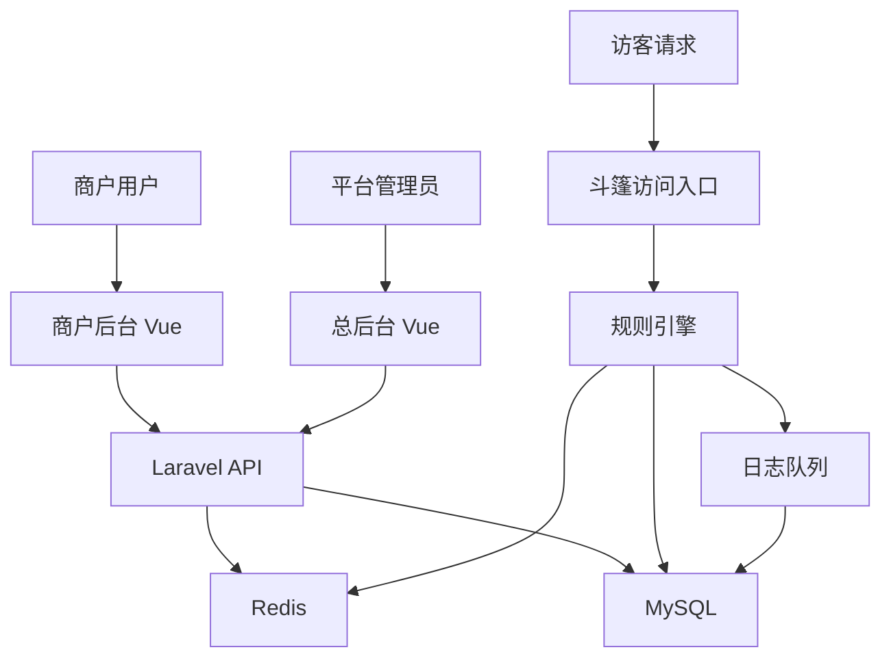

# 斗篷系统开发技术方案

## 1. 方案目标

本文档基于 `docs/prd.md` 的 MVP 范围，补充斗篷系统的开发落地方案。

当前技术方向调整为：

- 前端使用 Vue 技术栈，并以参考代码 `参考代码/ele-admin-plus-ruoyi-ultra-20251111/ele-admin-plus-ruoyi-ultra` 为模板。
- 前端需要复刻总后台和商户后台，复用参考代码中的布局、组件、交互方式、设计规范和权限风格。
- 后端使用 Laravel 开发，但接口风格、权限模型、菜单模型、日志模型和管理后台模块参考 RuoYi。
- 前后端通过 RuoYi 风格的接口协议适配，降低参考前端模板迁移成本。

## 2. 参考代码结论

参考前端项目是 Vue 后台模板，核心技术栈如下：

| 类型 | 选型 |
| --- | --- |
| 构建工具 | Vite |
| 前端框架 | Vue 3 |
| UI 组件库 | Element Plus |
| 后台框架组件 | EleAdmin Plus |
| 状态管理 | Pinia |
| 路由 | Vue Router |
| HTTP 请求 | Axios |
| 图表 | ECharts |
| 时间处理 | Dayjs |
| 样式 | SCSS |

参考项目中的核心规范：

- 使用 `ele-page`、`ele-card`、`ele-pro-table` 作为列表页基础结构。
- 使用 `btn-items` 统一渲染新增、编辑、删除、导出、详情等操作按钮。
- 使用 `dict-data` 和字典接口统一渲染状态、类型、日志类型等枚举字段。
- 使用 `/getInfo` 获取当前用户、角色和按钮权限。
- 使用 `/getRouters` 获取动态菜单，并由前端转换为 Vue Router 路由。
- 使用 RuoYi 风格权限字符串，例如 `system:user:add`、`monitor:operlog:export`。
- 使用统一接口返回结构：`code`、`msg`、`data`、`rows`、`total`。

因此，新系统不单独设计一套前端规范，而是在参考项目基础上替换业务菜单、业务页面和接口。

## 3. 总体架构



系统拆分为四个主要部分：

- 总后台：平台方使用，管理商户、域名、斗篷、日志、系统配置和数据看板。
- 商户后台：商户使用，管理本商户域名、斗篷、黑白名单、API Key 和日志。
- Laravel API：为两个后台提供管理接口，并提供 API 斗篷能力。
- 斗篷访问入口：接收绑定域名访问请求，执行规则判定并写入斗篷日志。

## 4. 前端技术方案

### 4.1 前端选型

沿用参考代码的 Vue 技术栈：

| 能力 | 方案 |
| --- | --- |
| 框架 | Vue 3 |
| 构建 | Vite |
| UI | Element Plus + EleAdmin Plus |
| 状态 | Pinia |
| 路由 | Vue Router 动态路由 |
| 请求 | Axios 请求封装 |
| 权限 | RuoYi 风格菜单权限 + 按钮权限 |
| 图表 | ECharts |
| 样式 | SCSS，沿用参考代码主题变量和布局规范 |

### 4.2 前端工程策略

建议先复制参考项目作为前端基础工程，再做业务改造：

- 保留 `src/layout`、`components`、`src/utils`、`src/store`、`src/router`、`src/styles` 等基础能力。
- 保留登录页、布局、主题设置、页签、动态菜单、字典组件、权限 Hook、请求封装。
- 删除或隐藏参考项目中无关业务页面。
- 新增斗篷系统业务模块页面。
- 接口路径尽量保持 RuoYi 风格，减少前端公共能力改造。

建议目录结构：

```text
frontend/
  src/
    api/
      cloak/
      merchant/
      system/
      monitor/
      dashboard/
      login/
      layout/
    views/
      dashboard/
      merchant/
      domain/
      cloak/
      cloak-log/
      api-cloak/
      api-log/
      access-list/
      system/
      monitor/
      login/
    components/
    layout/
    router/
    store/
    utils/
    styles/
```

### 4.3 后台入口策略

MVP 可以采用一个 Vue 工程、两类后台菜单的方式：

- 总后台用户登录后返回平台菜单。
- 商户后台用户登录后返回商户菜单。
- 前端根据 `/getInfo` 返回的角色和 `/getRouters` 返回的菜单动态生成路由。
- 登录页可共用，登录成功后按角色跳转首页。

这种方式复用度最高，也最符合参考项目的动态菜单模式。

后续如需独立部署，可再拆成两个前端应用：

- `admin-portal`：总后台。
- `merchant-portal`：商户后台。

### 4.4 总后台菜单设计

总后台面向平台管理员，菜单建议如下：

```text
首页
商户管理
  商户账号
  商户详情
域名管理
  全部域名
斗篷管理
  全部斗篷
  斗篷日志
API 管理
  API Key
  API 斗篷日志
名单管理
  黑白名单
系统管理
  用户管理
  角色管理
  菜单管理
  字典管理
  参数配置
监控日志
  登录日志
  操作日志
系统配置
  默认页配置
  日志保留配置
  API 额度配置
```

### 4.5 商户后台菜单设计

商户后台面向商户管理员和商户操作员，菜单建议如下：

```text
首页
域名管理
  域名列表
斗篷管理
  斗篷列表
  斗篷日志
名单管理
  黑白名单
API 斗篷
  API Key
  API 调用日志
操作日志
账号设置
  个人资料
  修改密码
```

### 4.6 前端页面开发规范

列表页应优先复用参考代码模式：

- 外层使用 `ele-page`。
- 搜索区抽成 `components/*-search.vue`。
- 表格使用 `ele-pro-table`。
- 弹窗表单抽成 `components/*-edit.vue`。
- 详情弹窗抽成 `components/*-detail.vue`。
- 工具栏和行操作使用 `btn-items`。
- 状态字段使用 `dict-data`。
- 权限控制使用 `permission` 字符串。

业务页面命名建议：

| 模块 | 页面路径 | API 模块 |
| --- | --- | --- |
| 商户账号 | `views/merchant/account` | `api/merchant/account` |
| 域名列表 | `views/domain/index` | `api/domain` |
| 斗篷列表 | `views/cloak/index` | `api/cloak` |
| 斗篷日志 | `views/cloak-log/index` | `api/cloak-log` |
| 黑白名单 | `views/access-list/index` | `api/access-list` |
| API Key | `views/api-cloak/key` | `api/api-cloak/key` |
| API 调用日志 | `views/api-log/index` | `api/api-log` |
| 数据看板 | `views/dashboard/index` | `api/dashboard` |

### 4.7 前端接口适配规范

沿用参考代码的接口响应判断：

```json
{
  "code": 200,
  "msg": "操作成功",
  "data": {}
}
```

分页接口统一返回：

```json
{
  "code": 200,
  "msg": "查询成功",
  "rows": [],
  "total": 0
}
```

登录与权限接口保持 RuoYi 风格：

| 接口 | 用途 |
| --- | --- |
| `POST /login` | 登录并返回 token |
| `GET /getInfo` | 当前用户、角色、权限 |
| `GET /getRouters` | 当前用户动态菜单 |
| `POST /logout` | 退出登录 |

请求头沿用：

```text
Authorization: Bearer <token>
```

## 5. 后端技术方案

### 5.1 后端选型

| 能力 | 方案 |
| --- | --- |
| 框架 | Laravel |
| 数据库 | MySQL |
| 缓存 | Redis |
| 队列 | Laravel Queue |
| 鉴权 | Laravel Sanctum 或 JWT |
| 权限 | RBAC，参考 RuoYi 菜单 + 角色 + 权限标识 |
| 日志 | 操作日志、登录日志、斗篷访问日志、API 调用日志 |
| 定时任务 | Laravel Scheduler |

### 5.2 Laravel 分层建议

```text
backend/
  app/
    Http/
      Controllers/
        Admin/
        Merchant/
        Api/
        Cloak/
      Middleware/
      Requests/
      Resources/
    Models/
    Services/
      Auth/
      Permission/
      Merchant/
      Domain/
      Cloak/
      Rule/
      Log/
      Dashboard/
    Repositories/
    Jobs/
    Enums/
    Support/
  routes/
    api.php
    admin.php
    merchant.php
    cloak.php
  database/
    migrations/
    seeders/
```

分层职责：

- `Controllers`：接收请求、调用服务、返回统一响应。
- `Requests`：参数校验。
- `Services`：业务逻辑，例如斗篷规则、域名校验、API Key 校验。
- `Repositories`：复杂查询封装。
- `Models`：Eloquent 数据模型。
- `Jobs`：异步写日志、统计汇总。
- `Enums`：状态、类型、动作枚举。
- `Support`：统一响应、分页、脱敏、IP 解析等工具。

### 5.3 RuoYi 兼容设计

为了复用参考前端，Laravel 后端需要提供以下 RuoYi 风格能力：

| RuoYi 能力 | Laravel 实现 |
| --- | --- |
| 用户管理 | `users`、`roles`、`permissions`、`menus` |
| 角色权限 | 角色关联菜单和权限标识 |
| 动态菜单 | `/getRouters` 根据角色返回树形菜单 |
| 当前用户信息 | `/getInfo` 返回 `user`、`roles`、`permissions` |
| 字典管理 | `dict_types`、`dict_data` |
| 参数配置 | `system_configs` |
| 操作日志 | 中间件或 Trait 记录写操作 |
| 登录日志 | 登录成功、失败、退出均记录 |
| 分页列表 | 返回 `rows` 和 `total` |

### 5.4 API 路由规划

平台总后台接口：

```text
/system/user
/system/role
/system/menu
/system/dict/type
/system/dict/data
/system/config
/monitor/operlog
/monitor/logininfor
/admin/merchant
/admin/domain
/admin/cloak
/admin/cloak-log
/admin/api-key
/admin/api-log
/admin/dashboard
```

商户后台接口：

```text
/merchant/dashboard
/merchant/domain
/merchant/cloak
/merchant/cloak-log
/merchant/access-list
/merchant/api-key
/merchant/api-log
/merchant/operlog
```

外部 API 斗篷接口：

```text
/open/cloaks
/open/cloaks/{id}
/open/cloaks/{id}/status
/open/cloak-logs
```

斗篷访问入口：

```text
/{any}
```

访问入口需要根据 Host 识别绑定域名，再执行斗篷判定。实际部署时建议将访问入口和管理 API 使用不同域名或不同 Nginx server block。

## 6. 数据库设计方向

### 6.1 系统与权限表

- `users`：后台用户，平台用户和商户用户共表，通过 `merchant_id` 区分。
- `roles`：角色。
- `menus`：菜单和按钮权限。
- `role_menu`：角色菜单关联。
- `user_role`：用户角色关联。
- `dict_types`：字典类型。
- `dict_data`：字典数据。
- `system_configs`：系统参数。
- `login_logs`：登录日志。
- `operation_logs`：操作日志。

### 6.2 斗篷业务表

- `merchants`：商户。
- `domains`：绑定域名。
- `cloaks`：斗篷策略。
- `cloak_rules`：斗篷规则明细，或使用 JSON 字段存储规则配置。
- `access_lists`：黑白名单。
- `api_keys`：商户 API Key。
- `cloak_access_logs`：斗篷访问日志。
- `api_call_logs`：API 调用日志。
- `dashboard_metrics`：统计汇总，可按小时或天聚合。

MVP 阶段建议 `cloaks.rules` 使用 JSON 字段保存规则配置，减少早期表结构复杂度；常用筛选字段如 `merchant_id`、`domain_id`、`status`、`created_at` 应单独建索引。

## 7. 核心业务实现

### 7.1 多商户隔离

所有商户侧业务表必须包含 `merchant_id`。商户后台查询必须默认追加 `merchant_id` 条件。总后台可以跨商户查询，但写操作需要记录平台操作日志。

建议实现：

- `MerchantScope`：商户数据查询范围。
- `EnsureMerchantEnabled`：校验商户状态。
- `CurrentTenant`：保存当前请求商户上下文。

### 7.2 斗篷规则引擎

斗篷判定顺序：

1. 根据 Host 查询域名。
2. 校验域名状态和商户状态。
3. 获取域名关联的启用斗篷。
4. 加载商户全局名单和斗篷专属名单。
5. 白名单优先判定。
6. 黑名单判定。
7. 执行 IP、地区、设备、UA、Referer、频次规则。
8. 生成最终动作：白页、黑页、拦截、404。
9. 异步写入访问日志。

规则引擎建议拆分为：

- `DomainResolver`：域名解析。
- `CloakResolver`：斗篷查找。
- `ListMatcher`：黑白名单匹配。
- `RuleMatcher`：规则匹配。
- `ActionResolver`：最终动作。
- `CloakLogWriter`：日志写入。

### 7.3 缓存策略

高频访问判定不能每次查数据库，建议缓存：

- 域名配置：`cloak:domain:{host}`。
- 斗篷配置：`cloak:strategy:{cloak_id}`。
- 商户状态：`cloak:merchant:{merchant_id}`。
- 黑白名单：`cloak:list:{merchant_id}:{cloak_id}`。
- 频次计数：`cloak:freq:{cloak_id}:{ip_hash}:{period}`。

域名、斗篷、名单、商户状态变更后，需要主动清理相关缓存。

### 7.4 日志策略

访问日志和 API 调用日志数据量较大，建议异步写入：

- 管理后台操作日志：同步或事务后写入。
- 斗篷访问日志：队列异步写入。
- API 调用日志：请求结束后写入，可异步。
- 统计数据：定时任务按小时或天聚合。

日志字段中的 IP、UA、Referer 默认脱敏或摘要展示，详情权限由角色控制。

## 8. 权限标识规范

权限标识沿用 RuoYi 风格：

```text
模块:资源:动作
```

示例：

| 功能 | 权限标识 |
| --- | --- |
| 商户新增 | `merchant:account:add` |
| 商户编辑 | `merchant:account:edit` |
| 域名新增 | `cloak:domain:add` |
| 域名删除 | `cloak:domain:remove` |
| 斗篷新增 | `cloak:strategy:add` |
| 斗篷启停 | `cloak:strategy:status` |
| 斗篷日志导出 | `cloak:log:export` |
| API Key 重置 | `cloak:apiKey:reset` |
| 操作日志查询 | `monitor:operlog:list` |

超级管理员保留 `*:*:*` 全权限。

## 9. 开发阶段建议

### 9.1 第一阶段：基础框架

- 复制参考 Vue 项目为前端基础工程。
- 初始化 Laravel 后端工程。
- 实现登录、退出、`/getInfo`、`/getRouters`。
- 实现用户、角色、菜单、字典、参数配置基础模块。
- 打通动态菜单和按钮权限。

### 9.2 第二阶段：商户与域名

- 实现商户账号管理。
- 实现商户后台菜单隔离。
- 实现域名新增、校验、启停、删除。
- 实现域名缓存和状态同步。

### 9.3 第三阶段：斗篷核心

- 实现斗篷列表、创建、编辑、启停、复制、删除。
- 实现黑白名单。
- 实现斗篷访问入口和规则引擎。
- 实现访问日志异步写入。

### 9.4 第四阶段：API 与日志

- 实现 API Key 管理。
- 实现外部 API 斗篷接口。
- 实现 API 调用日志。
- 完善操作日志和登录日志。

### 9.5 第五阶段：数据看板

- 实现商户数据看板。
- 实现平台数据看板。
- 实现访问趋势、命中趋势、API 调用趋势。
- 增加定时聚合任务。

## 10. 交付标准

- 前端视觉、布局、表格、弹窗、按钮、字典、权限交互与参考代码保持一致。
- 总后台和商户后台通过动态菜单区分，不重复维护两套基础布局。
- Laravel 接口返回结构兼容参考前端。
- 商户数据严格按 `merchant_id` 隔离。
- 斗篷访问入口可以根据域名执行规则判定。
- 关键写操作、访问判定和 API 调用均可追踪日志。
- 文档、数据库、接口和前端菜单保持同一套命名规范。
