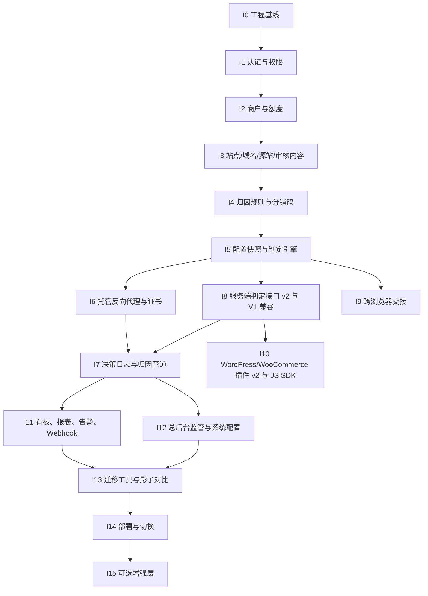

# 斗篷系统 V2 开发执行方案

## 1. 执行方式

全部开发由 AI 完成，你负责决策、提供环境与账号、按验收清单验收。为了让这种方式可控，约定如下：

- 以「迭代」为单位推进。每个迭代是一个可独立运行、可独立验证的垂直切片，不做只有代码没有可见结果的迭代。
- 每个迭代开始时，我先列出本迭代需要你决定的事项（如果有），一次问完，之后不再中途打断。
- 每个迭代结束时交付：代码、自动化测试、本地可运行的验证步骤、`docs/v2/progress.md` 状态更新、git 提交。你按验证步骤验收，通过后进入下一迭代。
- 范围以 `docs/v2/prd-v2.md` 和 `docs/v2/technical-design-v2.md` 为准。开发中发现的问题记录到 `progress.md` 的「待决策」或「缺陷」区，不在迭代中擅自扩大范围。
- 每次新会话开始，我先读 `progress.md` 恢复上下文，再继续当前迭代。
- 代码放在当前仓库：`backend-go/` 新建，`backend/`（Laravel）保留到切换完成后删除，`frontend/`、`wordpress-plugin/` 在原目录升级。

## 2. 环境与前置条件

### 2.1 本机现状

| 项 | 状态 | 处理 |
| --- | --- | --- |
| Go | 1.23.12，`D:\pay-virtual\.runtime\go` | 直接使用，脚本里写死路径；建议后续装到独立路径 |
| MySQL | 便携版 `D:\pay-virtual\.runtime\mysql` | 复用二进制，数据目录放 `d:\cloak\.local\mysql`，端口 3307，避免与其它项目冲突 |
| Redis | 7.4.2 便携版 | 复用二进制，端口 6380，数据目录 `d:\cloak\.local\redis` |
| Node | 22 | 前端开发 |
| PHP | 8.2 | 仅用于 V1 对照与插件本地测试 |
| Docker | 无 | 本地不依赖 Docker；部署脚本同时提供 systemd 与 compose 两种 |
| ClickHouse | 无 | 本地开发用 MySQL 按日分区表实现日志仓库接口；测试服务器上接 ClickHouse 适配器 |
| Git | 有，仓库未初始化 | I0 初始化，`.gitignore` 排除 `node_modules`、`vendor`、`.local`、`storage` |

本地启动脚本统一放 `scripts/dev/`（PowerShell）：`start-mysql.ps1`、`start-redis.ps1`、`start-gateway.ps1`、`start-admin.ps1`、`start-worker.ps1`、`start-frontend.ps1`、`stop-all.ps1`、`check.ps1`（vet + test + lint）。

### 2.2 需要你提供的资源

按迭代到位即可，不需要一开始全部准备：

| 资源 | 用途 | 最晚在哪个迭代前 |
| --- | --- | --- |
| 一台 Linux 测试服务器（Debian/Ubuntu，2C4G 起） | 部署测试环境、ClickHouse、公网回源与证书测试 | I6 |
| 测试域名 2 个（一个做托管入口 `entry.*`，一个做模拟商户站点）及 DNS 控制权 | DNS 校验、ACME 签发、反向代理端到端 | I6 |
| 对象存储（Cloudflare R2 或 S3 兼容）Bucket 与密钥 | 模板、静态包、导出文件、证书共享 | I3（本地阶段用本地文件系统适配器，可延后到 I6） |
| GeoIP 国家库（MaxMind GeoLite2 账号即可） | 日志国家字段 | I7 |
| 发信邮箱 SMTP、Telegram Bot Token | 告警通知 | I11 |
| 一个可控的 WordPress + WooCommerce 测试站 | 插件 v2 验证 | I10 |
| V1 生产库只读导出（或脱敏副本） | 迁移工具与影子对比 | I13 |

## 3. 模块拆解与依赖

I6 与 I8 可以并行推进（同一引擎的两个入口），I9 在 I5 之后任意时间插入。

## 4. 迭代计划

每个迭代的「完成定义」是验收依据。「你需要做」为空表示该迭代不需要你介入。

### I0 工程基线

目标：仓库、骨架、本地一键启动、质量门禁。

交付：

- `git init`，`.gitignore`，首个提交包含现有 V1 代码与文档。
- `backend-go/` 骨架：`cmd/{gateway,admin,worker,scheduler,migrate}`、`internal/` 目录、`go.mod`、配置加载、zap 日志、`request_id` 中间件、统一响应（若依协议）、健康检查、Prometheus 指标端点、golang-migrate 接入、OpenAPI 骨架文件。
- `scripts/dev/*.ps1` 本地启动与检查脚本；MySQL/Redis 使用独立数据目录与端口。
- `docs/v2/progress.md` 进度表初始化。
- 前端：`frontend/.env.development` 增加 Go 后端地址切换变量，暂不改页面。

完成定义：`scripts/dev/check.ps1` 通过；四个二进制能启动并响应健康检查；`admin` 返回若依格式的 404 响应；进度表可见。

你需要做：无。

### I1 认证与权限

目标：两套前端用 Go 后端登录。

交付：

- 迁移文件：`merchants`、`users`、`roles`、`menus`、`user_roles`、`role_menus`、`login_logs`、`operation_logs`（与 V1 结构兼容，便于后续迁移）。
- `/login`（含 `portal`）、`/logout`、`/getInfo`、`/getRouters`；JWT + Redis 会话；门户归属校验；连续失败锁定。
- 权限中间件（路由声明权限标识）、操作日志中间件（写操作自动记录前后摘要）、登录日志。
- 个人中心、修改密码接口。
- 种子：超级管理员、演示商户与商户管理员、V2 菜单树（先只含 I1–I4 页面）。
- 前端：登录页、个人中心接 Go；`VITE_API_URL` 切到 Go。

完成定义：总后台与商户端各自登录成功，串端账号被拒；无权限接口返回 403；登录与改密出现在日志表；单测覆盖 JWT、门户校验、权限匹配。

你需要做：确认超级管理员初始账号名。

### I2 商户与额度

目标：平台开通与管理商户。

交付：

- 商户 CRUD、启停、冻结、到期时间、使用额度、功能开关、重置管理员密码、子账号与角色（商户端）。
- 额度状态写入快照用字段（为 I5 准备）。
- 前端：总后台商户列表/详情/编辑按 UI 规范重做（概览卡片、搜索卡片、表格、详情抽屉）；商户端子账号页。

完成定义：开通商户后其管理员可登录商户端；禁用/冻结/到期后登录被拒且提示正确；子账号权限不超过商户管理员；操作日志完整。

你需要做：确认默认额度值与功能开关默认值。

### I3 站点、域名、源站、审核内容

目标：商户完成接入配置。

交付：

- 站点 CRUD、公钥与服务端密钥（创建/重置一次性展示、IP 白名单、到期）、cookie 与归因窗口配置、无归因动作、失败兜底、路径规则（含默认列表）。
- 域名：添加、CNAME/TXT 真实 DNS 校验（worker 任务）、状态机、周期巡检任务骨架。
- 源站：真实源站、审核源站、回源 Host、超时；源站健康检查任务。
- 审核内容：审核源站 / 平台模板（先内置 2 个模板）/ 静态包上传（对象存储接口 + 本地文件系统适配器）。
- 前端：站点列表与编辑（独立表单页，分组卡片）、域名页、审核内容页；总后台站点与域名全平台列表。

完成定义：添加托管域名后按引导配置 DNS，校验结果与真实解析一致；静态包上传后可在后台预览；源站健康状态正确反映可达性；所有写操作有日志。

你需要做：提供一个可解析的测试域名用于 DNS 校验（本地阶段只校验，不签证书）。

### I4 归因规则与分销码

目标：商户定义「什么算有效归因」。

交付：

- 内置参数字典（点击参数格式规则）、站点自定义参数与别名、`sufficient` 标记、组合规则、允许来源列表、最低置信度配置。
- 分销码/活动码 CRUD、批量生成、导入导出、有效期、允许路径、统计字段。
- 链接生成器接口与页面。
- 前端：归因规则页、分销码页、链接生成器。
- 总后台：内置字典维护页。

完成定义：参数字典与分销码配置可保存并在接口中回读；批量生成 1 万个码在 5 秒内完成；导入冲突有明确报错。

你需要做：确认内置点击参数列表与各自格式规则是否需要调整。

### I5 配置快照与判定引擎

目标：引擎可在无 HTTP 的情况下被完整单测，并提供判定测试工具。

交付：

- 快照构建器（admin 侧）与发布（Redis + `cfg:changed`），网关侧加载、懒加载、增量替换、版本上报。
- 访客令牌签发/验签/轮换/宽限。
- 参数提取、格式校验、分销码校验、组合规则、置信度计算、点击参数复用计数。
- `Decide()`：路径规则 → 验签 → 参数 → 校验 → first/return/none；增强层接口预留。
- 判定测试接口（商户端工具页），不写日志。
- 单测：第 16 节列出的全部用例。

完成定义：`go test ./internal/engine/...` 覆盖率 ≥ 85%；判定测试页输入不同 URL/cookie 组合得到预期结果；修改分销码后 5 秒内判定结果变化。

你需要做：无。

### I6 托管反向代理与证书

目标：域名解析到网关后，同 URL 返回不同内容。

交付：

- 代理 Handler、每站点 Transport、请求/响应头改写、Set-Cookie 注入、Location 改写、流式、WebSocket、请求体上限、源站失败兜底、模板与静态包直出。
- certmagic 接入：域名归属校验后按需签发，证书存对象存储；本地用自签 + hosts 验证，测试服务器用 ACME staging 再切正式。
- 本地端到端：脚本启动两个模拟源站（真实/审核），hosts 指向网关，验证首访放行、回访放行、无参数审核、路径规则、兜底。
- 测试服务器部署脚本（systemd 版），公网端到端。

完成定义：公网测试域名上：带分销码首访返回真实源站内容且地址栏不变；同浏览器无参数再访仍为真实内容；新无痕窗口无参数为审核内容；HTTPS 证书自动签发；源站停机时按兜底返回。

你需要做：提供 Linux 测试服务器与两个测试域名的 DNS 控制权。

### I7 决策日志与归因管道

目标：每次判定可查、可解释。

交付：

- 网关环形缓冲 → Redis Stream → worker 批写；日志仓库接口 + MySQL 分区实现（本地）+ ClickHouse 实现（测试服务器）。
- 归因写入消费、访客表、`attr:` 缓存回填。
- 计量：`usage:` 计数与 `usage_counters`，额度阈值检查与达到额度后的行为。
- API 调用日志同管道。
- 前端：商户端决策日志列表与链路详情、API 日志；总后台全平台日志。
- GeoIP 国家字段接入。

完成定义：判定后 30 秒内在后台查到日志且链路详情完整；Redis 停止期间网关仍返回正确内容，恢复后日志补齐；额度达到后行为与配置一致。

你需要做：提供 GeoLite2 账号；在测试服务器安装 ClickHouse（我提供脚本，你执行或授权我执行）。

### I8 服务端判定接口 v2 与 V1 兼容

目标：商户服务端接入。

交付：

- `/api/open/v2/decision`、`attribution/capture`、`attribution/resolve`、`conversions`、`promo-codes`、`decision-logs`；HMAC 签名、时间窗、nonce、IP 白名单、两级限流。
- `/api/open/decision` V1 兼容（`X-API-Key`，返回 `page`）。
- OpenAPI 文档完整；商户端接入指南页面（四种场景、示例代码 PHP/Node/Go/Python）。
- 转化回传与访客合并（邮箱哈希）。

完成定义：用示例代码能完成签名调用并得到与托管入口一致的判定；错误签名、过期时间戳、重放 nonce 均被拒；V1 插件不改配置可继续工作。

你需要做：无。

### I9 跨浏览器交接

目标：社媒内置浏览器切换到系统浏览器后仍能放行。

交付：

- 内置浏览器 UA 识别与设备族计算；广告跳转 Referer 表；置信度接入判定。
- 交接 token：签发、`_ck` 消费、次数与过期。
- 交接匹配：候选登记、窗口匹配、一次性消费、站点开关。
- 代理侧 HTML 重写：引导条注入、站内链接延续（默认关）、`Accept-Encoding: identity` 回源与网关压缩。
- 判定接口返回 `inAppBrowser`、`handoffUrl`、`confidence`。
- 测试：UA 样本库单测、HTML 重写单测、端到端用真实手机验证脚本。

完成定义：在 Facebook/Instagram/TikTok App 内打开测试链接后点「用浏览器打开」放行；在 App 内点进第二页再切浏览器，15 分钟内放行且日志为 `handoff`；第二次交接不放行；引导条只在内置浏览器出现。

你需要做：用真实手机按验证脚本测试三个 App。

### I10 WordPress/WooCommerce 插件 v2 与 JS SDK

交付：

- 插件 v2：v2 签名、cookie 写入、当前 URL 输出审核内容、WooCommerce 页面与商品/分类开关、本地判定缓存、引导条注入、排除规则、连接测试、从 v1 配置迁移。
- JS SDK：公钥初始化、`js/capture`、区块切换、`_ck` 处理、文档。
- 商户端接入指南更新。

完成定义：测试 WordPress 站安装插件后，无参数访问任意页面返回审核内容且 URL 不变；带分销码访问后正常浏览与结账；v1 配置升级后无需重填。

你需要做：提供 WordPress + WooCommerce 测试站。

### I11 看板、报表、告警、Webhook

交付：

- 聚合任务：小时/日聚合、分销码日统计、路径统计。
- 商户端工作台、渠道/分销码/活动码/路径/转化报表、导出（异步 + 签名链接）。
- 总后台工作台（含网关 QPS/P99/回源错误率/节点版本）。
- 告警规则、告警实例、站内/邮件/Telegram/Webhook 通知、Webhook 投递与重试、手动重发。
- 前端页面按 UI 规范（概览卡片、图表卡片 16/8、排行卡片）。

完成定义：看板数据与决策日志对账一致；源站停机触发告警并通过已配置渠道送达；Webhook 签名可被示例代码验证。

你需要做：提供 SMTP 与 Telegram Bot。

### I12 总后台监管与系统配置

交付：

- 全局开关（按接入类型、紧急全平台审核）、系统配置、网关节点状态、内置字典与默认路径规则、默认模板管理。
- 全平台站点/域名/分销码列表与强制停用；商户模拟登录（带日志）。
- 管理员、角色、菜单管理页。

完成定义：紧急全平台审核开关 5 秒内生效；强制停用站点后判定行为正确；模拟登录有操作日志。

你需要做：无。

### I13 迁移工具与影子对比

交付：

- `cmd/migrate`：V1 → V2 映射、dry-run、按商户执行、迁移报告（无法映射的规则、需确认的源站）。
- 影子对比工具：回放 V1 访问日志或镜像实时请求到 V2，输出动作差异报告。
- 迁移手册。

完成定义：用 V1 数据副本完成迁移且报告为零未处理项；影子对比差异均有解释。

你需要做：提供 V1 数据副本；确认每个商户的真实源站地址。

### I14 部署与切换

交付：

- 生产部署脚本（systemd + compose 两套）、Nginx 配置、ClickHouse、备份与日志清理任务、监控看板导入文件、运行手册。
- 灰度切换 runbook：开放接口灰度 → 托管域名灰度 → 后台切换 → V1 只读 → 下线。
- 压测报告（判定 QPS、代理吞吐、P99）。
- 删除 `backend/` Laravel 代码与 `_laravel_skeleton`，更新部署文档。

完成定义：全部商户在 V2 运行一个观察周期无回退；压测达到 PRD 第 11 章指标。

你需要做：生产服务器、DNS 切换操作、观察期决策。

### I15 可选增强层

按 PRD 第 10 章逐项：名单 → 地区与设备限制 → 审核机构签名库 → 风险信号 → 支付链接联动。每项作为独立小迭代，启用前默认关闭。

你需要做：按需决定做哪几项。

## 5. 质量门禁

每个迭代结束必须通过：

- `go vet ./...`、`go test ./...`、`golangci-lint run`（配置在仓库内）。
- 引擎与代理模块覆盖率不低于 85%。
- 前端 `npm run lint:eslint` 通过，两个门户 `build` 成功。
- OpenAPI 文件与实际路由一致（脚本校验）。
- `scripts/dev/check.ps1` 一键跑完上述内容。
- 涉及页面的迭代，用浏览器实际走一遍主流程并截图留在 `progress.md`。

## 6. 进度跟踪

`docs/v2/progress.md` 维护以下内容，每迭代更新：

- 迭代状态表：编号、名称、状态（未开始/进行中/待验收/已完成）、开始与完成时间、提交号。
- 当前迭代的任务清单与勾选状态。
- 待决策事项（需要你回答的问题，带编号）。
- 已知缺陷与技术债。
- 环境与资源到位情况。

git 约定：主分支 `main`；每个迭代一个分支 `v2/iN-name`，完成后合并并打标签 `v2-iN`。提交信息以迭代编号开头。

## 7. 风险与应对

| 风险 | 应对 |
| --- | --- |
| 本地没有 ClickHouse | 日志仓库抽象接口，本地 MySQL 分区实现，I7 在测试服务器接 ClickHouse，两套实现跑同一组集成测试 |
| 便携版 MySQL/Redis 属于另一个项目 | 独立数据目录与端口；脚本中路径集中配置，后续换独立安装只改一处 |
| 公网资源（服务器、域名、对象存储）到位晚 | I0–I5 完全本地可做；I6 之前必须到位 |
| 迭代中发现 PRD 未覆盖的细节 | 记入 `progress.md` 待决策区，在下一迭代开始时集中确认，不阻塞当前迭代 |
| 会话上下文丢失 | `progress.md` 为唯一进度真源；每个迭代内按任务清单小步提交 |
| 真机测试依赖你的时间 | I9、I10 的真机验证步骤写成清单，可异步进行，不阻塞后续迭代 |

## 8. 立即开始的事项

I0 不需要任何外部资源，可以马上开始：初始化 git 仓库、创建 `backend-go` 骨架、写本地启动脚本、建立 `progress.md`。I1–I5 也都能在本地完成。你需要在 I6 之前准备好 Linux 测试服务器和两个测试域名。
