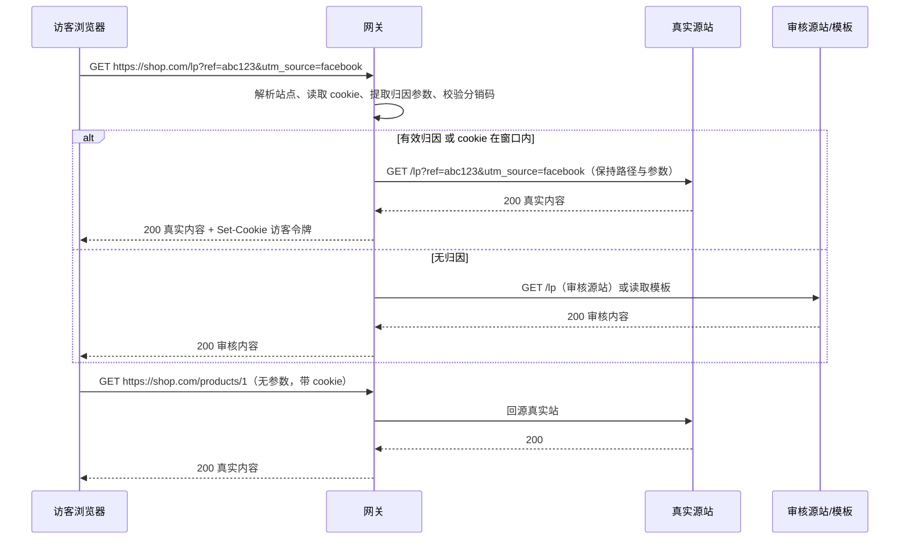

# 斗篷系统 V2 重构 PRD：归因放行网关

## 1. 文档信息

| 项目 | 内容 |
| --- | --- |
| 产品名称 | 斗篷系统 V2（归因放行网关） |
| 文档版本 | v2.1 |
| 适用阶段 | V2 重构：后端迁移到 Go，产品重心收敛为「按归因放行」 |
| 上游文档 | `docs/prd.md`（v0.2）、`docs/technical-design.md`、`docs/前端UI规范.md` |
| 配套文档 | `docs/v2/technical-design-v2.md` |
| 服务对象 | 平台合作商户，由平台直接开通，不做套餐售卖，不设渠道商/代理 |

## 2. 核心诉求

商户网站只对「从流量渠道或分销渠道来的真实客户」展示真实内容。判断依据是访问是否携带有效的归因参数，或者该浏览器此前已经通过归因进入过。

- 访客带着有效归因参数打开网站：返回真实内容，并给这个浏览器种下访客 cookie。
- 这个浏览器之后在站内继续浏览、或再次打开不带参数的链接：凭 cookie 仍返回真实内容，直到归因窗口到期。
- 没有归因参数、也没有有效 cookie 的访问：返回商户配置的审核内容。
- 全程不跳转。浏览器地址栏的 URL 保持访客打开时的原样，HTTP 状态保持 200，只是服务器返回的内容不同。

一句话：同一个链接，有归因的人看到真实站，没归因的人看到审核站。

## 3. 现状盘点

V1 代码事实，V2 以此为重构起点。

| 项 | 现状 | 与核心诉求的差距 |
| --- | --- | --- |
| 判定依据 | 按 IP、UA、Referer、投放地区、设备等规则 | 不看归因参数，不识别回访 |
| 返回方式 | 托管入口 302 跳转到审核页或真实页；API 入口返回 `review/real` 由调用方处理 | 302 会改变 URL，不满足「链接不变」 |
| 访客 | 请求结束后不保留任何访客信息 | 没有 cookie、没有归因窗口，回访无法放行 |
| 渠道 | 只看 Referer 是否包含 facebook/google/tiktok/kwai | 不读 `utm_*`、`fbclid`、`gclid`、分销码 |
| 分销 | 无 | 无分销码登记与校验 |
| 入口 | 托管域名、`POST /open/decision`、WordPress 插件 | 插件已有「HTML 输出」模式可做到同 URL 不同内容，托管入口需改为反向代理 |
| 日志 | 访问日志、API 日志同步写库 | 无触点类型、无命中参数、无分销码 |
| 其它 | 两套前端已按总后台/商户端拆分；若依风格接口；Laravel 12 | 后端迁 Go，前端保留 |

V1 的策略字段（审核页、真实页、运行模式、投放地区、屏蔽 PC/代理、蜘蛛白名单等）在 V2 中不再是判定主线，部分作为可选增强保留（见第 10 章）。

## 4. 术语

| 术语 | 说明 |
| --- | --- |
| 真实内容 | 真实客户应看到的网站内容，来自商户真实源站 |
| 审核内容 | 无归因访问看到的内容，来自审核源站、平台托管模板或商户上传的静态包 |
| 归因参数 | URL 查询参数中能证明访客来源的参数：广告点击参数、`utm_*`、分销码、活动码 |
| 有效归因 | 归因参数通过站点配置的校验规则（分销码在登记列表内且有效、点击参数格式正确、来源在允许列表内） |
| 分销码 | 商户给分销商、推广员、合作方分配的推广标识，出现在链接参数中，如 `?ref=abc123` |
| 活动码 | 商户给某次投放或活动分配的标识，如 `?campaign=spring2026` |
| 访客 | 同一浏览器在某站点上的身份，由第一方 cookie 中的签名访客令牌表示 |
| 归因窗口 | 从有效归因进入算起，cookie 持续放行的时长，按站点配置 |
| 触点类型 | 首访（本次带有效参数）、回访（无参数但 cookie 有效）、交接（无参数无 cookie，但通过交接 token 或跨浏览器交接匹配放行）、无归因 |
| 内置浏览器 | 社媒 App 内嵌的 WebView，cookie 与系统浏览器隔离 |
| 交接 token | 放行后生成的短效参数 `_ck`，用于把归因从内置浏览器带到系统浏览器 |
| 来源置信度 | 平台对「访客来自广告或分销渠道」这一判断的可信程度：high / medium / low |
| 站点 | 商户接入的一个网站，持有域名、源站配置、归因规则、密钥 |
| 托管接入 | 商户域名解析到网关，网关反向代理到真实源站或审核源站 |
| 服务端接入 | 商户服务端（插件或自有代码）调用判定接口，按结果渲染内容 |

## 5. 范围

### 5.1 V2 包含

- 账号权限：平台管理员、商户管理员、商户操作员、商户只读；接口侧权限校验；登录保护。
- 商户：平台直接开通、启停、到期、使用额度与功能开关。
- 站点与域名：站点配置、托管域名 DNS 校验与证书自动签发、自有域名。
- 归因规则：参数字典、分销码与活动码登记、校验规则、归因窗口、路径规则。
- 判定与返回：托管反向代理、服务端判定接口、WordPress/WooCommerce 插件 v2、JS SDK（辅助）。
- 访客与归因：访客令牌、首访捕获、回访解析、归因记录、转化回传。
- 审核内容：审核源站、平台模板、静态包托管。
- 日志与审计：决策日志（含触点、参数、分销码、校验结果）、API 日志、操作日志、登录日志。
- 看板与报表：按站点、渠道、分销码的访问、放行、审核、回访、转化。
- 告警与 Webhook：域名异常、证书到期、源站不可达、审核流量占比异常、额度。
- 总后台：商户、站点、域名、分销码监管、全局开关、系统配置。
- V1 迁移与接口兼容。

### 5.2 V2 可选增强（后续阶段，第 10 章）

- 黑白名单。
- 审核机构识别与风险信号（带参数的审核流量也能被识别）。
- 支付链接与收单通道账号风险联动。

### 5.3 不包含

- 套餐、计费、账单、发票、自助注册。
- 渠道商、代理、分销层级门户。分销码只是归因标识，不含分佣与结算。
- 跨浏览器识别、浏览器指纹作为身份、IP 作为身份。
- 机器学习。
- 可视化页面编辑器。

## 6. 角色与门户

| 角色 | 门户 | 说明 |
| --- | --- | --- |
| 超级管理员 | 总后台 | 全部权限 |
| 运营管理员 | 总后台 | 商户、站点、域名监管与数据查看，不可改系统配置 |
| 商户管理员 | 商户端 | 管理本商户全部资源与子账号 |
| 商户操作员 | 商户端 | 按授权操作站点、归因规则、分销码，查看日志 |
| 商户只读 | 商户端 | 只看看板、日志、报表 |
| 商户服务端 | 开放 API | 服务端密钥，调用判定、归因、分销码接口 |
| 商户网页 | JS SDK | 公钥，仅做上报，不能做判定写操作 |

总后台与商户端为两套独立构建、独立部署的前端，登录时校验账号归属门户。

## 7. 业务流程

### 7.1 接入方式

| 接入 | 谁返回内容 | 谁写 cookie | URL | 适用 |
| --- | --- | --- | --- | --- |
| 托管接入 | 网关反向代理真实源站或审核源站 | 网关（域名就是商户域名，属第一方） | 不变 | 独立站、落地页、任何 HTTP 站点，商户无需改代码 |
| 服务端接入 | 商户服务端按判定结果渲染 | 商户服务端，用判定接口返回的 cookie 指令 | 不变 | WordPress/WooCommerce、自研站点 |
| JS SDK | 商户网页按判定结果切换展示 | 网页脚本 | 不变 | 纯静态页且无法改服务端时的辅助方案，内容已下发到浏览器，防护弱于前两种 |

### 7.2 托管接入流程

### 7.3 服务端接入流程

1. 访客请求到达商户服务端。
2. 服务端读取请求中的 cookie 与查询参数，连同 IP、UA、Referer、完整 URL 调用 `POST /open/v2/decision`。
3. 平台返回 `content: real | review`、触点类型、访客令牌与 cookie 指令。
4. 服务端按结果渲染真实页或审核页，状态 200，URL 不变；按指令写 cookie。
5. WordPress 插件在 `template_redirect` 完成上述步骤，审核内容用「站内页面渲染」或「HTML 输出」方式在当前 URL 下输出。

### 7.4 统一判定顺序

1. 入口校验：站点、域名、商户状态、密钥、签名、限流、额度。
2. 路径规则：命中「不参与判定」的路径（静态资源、回调、`robots.txt` 等）直接按规则处理。
3. 读取访客 cookie，验签。
4. 提取 URL 中的归因参数，按站点参数字典匹配。
5. 校验：分销码/活动码必须在登记列表中且状态有效、未过期、在允许路径内；点击参数符合格式；`utm_source` 在允许来源内（若配置）。
6. 有有效归因且来源置信度达到站点要求：写入或更新归因记录（首次渠道保留，最近渠道更新），生成或续期访客令牌，返回真实内容，触点类型 `first`。
7. 无有效归因但 cookie 有效且在窗口内：返回真实内容，触点类型 `return`，按配置续期。
8. 无参数无 cookie，但 URL 带有效交接 token `_ck`，或命中跨浏览器交接匹配（第 8.4.6 节）：返回真实内容并种新 cookie，触点类型 `handoff`。
9. 其余：返回审核内容，触点类型 `none`。无归因时的动作可配置为审核内容、拦截、404。
10. 可选增强层（启用时）：名单与审核机构识别可覆盖上述结果，见第 10 章。
11. 异步写决策日志与计量。

### 7.5 已知行为

- 真实客户把不带参数的链接转发给他人，对方看到审核内容。这是设计结果，商户应通过分销码或带参数的分享链接解决。
- cookie 被清除后访客视为新访客。换浏览器时按第 8.4.6 节分层处理：参数随 URL 传递与交接 token 可确定放行，交接匹配是短窗口概率放行，超出窗口视为新访客。
- 广告平台审核员点击广告链接时同样带参数，仅靠归因无法区分；需要时启用第 10 章的审核机构识别。
- 跨浏览器交接匹配在运营商 NAT 环境下存在把同 IP 其他访客放行的可能，窗口越长风险越大，商户可缩短窗口或关闭。

## 8. 功能需求

### 8.1 账号与权限

- 平台与商户用户共表，按 `merchant_id` 区分；角色分平台域与商户域。
- 商户管理员可创建子账号、分配角色、禁用、重置密码。
- 权限标识沿用 `模块:资源:动作`，接口侧按标识校验。
- 登录保护：连续失败锁定、可选 TOTP、登录 IP 白名单。
- 登录、退出、改密、子账号与权限变更记录操作日志。

### 8.2 商户与使用额度

- 商户由平台在总后台开通，字段：名称、联系人、状态（启用、禁用、过期、冻结）、到期时间（可空）、使用额度、功能开关、备注。
- 使用额度：判定次数/月、站点数、域名数、分销码数、子账号数、日志保留天数。
- 功能开关：托管接入、服务端接入、JS SDK、转化回传、Webhook、可选增强层。
- 达到额度后的行为按商户配置：只告警（默认）、全部返回审核内容、拒绝服务。
- 到期后管理只读、判定全部返回审核内容并告警；延长到期后自动恢复。

### 8.3 站点

站点是接入单元，一个商户可有多个站点。

- 基础：名称、类型（托管、服务端、混合）、状态、备注。
- 域名：允许域名列表；托管域名走 DNS 校验与证书签发；服务端接入的自有域名只做来源校验。
- 源站（托管接入）：真实源站地址、审核内容来源（审核源站地址 / 平台模板 / 上传静态包）、回源 Host 头、回源协议、超时、源站健康检查。
- 密钥：公钥（JS 用）、服务端密钥（只展示一次，可设 IP 白名单与到期）。
- 归因窗口：天数，默认 30；续期方式：固定窗口 / 每次访问滑动续期。
- 跨浏览器交接：引导条开关与文案、站内链接延续开关、交接 token 有效期与次数、交接匹配开关与窗口分钟数、放行所需最低来源置信度。
- cookie：名称可配，`HttpOnly`、`Secure`、`SameSite=Lax`，Domain 默认当前域名，可设为父域以覆盖子域。
- 无归因动作：审核内容（默认）/ 拦截 / 404。
- 失败兜底：源站不可达或判定异常时返回审核内容 / 真实内容 / 维护页。
- 路径规则：
  - 不参与判定的路径（直接回源真实站或直接放行）：静态资源后缀、`/wp-admin`、`/wp-json`、支付回调、`robots.txt`、`sitemap.xml` 等，提供默认列表可改。
  - 始终审核的路径。
  - 始终真实的路径（如隐私政策、条款）。
- 平台可强制停用站点。

验收：托管域名在 DNS 校验通过后 5 分钟内可通过 HTTPS 访问；源站配置变更 5 秒内生效；停用站点后返回审核内容或拒绝服务（按平台配置）。

### 8.4 归因规则

#### 8.4.1 参数字典

- 内置点击参数：`fbclid`、`gclid`、`gbraid`、`wbraid`、`ttclid`、`twclid`、`msclkid`、`kwai_click_id` 及 Kwai 其它点击参数、`sclid`、`li_fat_id`。每个内置参数有默认格式校验（长度区间、字符集）。
- 内置来源参数：`utm_source`、`utm_medium`、`utm_campaign`、`utm_content`、`utm_term`。
- 自定义参数：站点可追加参数名，并指定类型：分销码、活动码、点击参数、来源参数、自由参数。
- 每个参数可单独启用/停用，可设置「是否单独足以放行」。例如 `utm_medium` 单独出现不放行，`fbclid` 单独出现放行。
- 参数大小写与别名：支持别名列表，如 `ref`、`r`、`aff` 都映射为分销码。

#### 8.4.2 归因码登记

- 归因码：码值、名称、渠道标签、状态、有效期、允许落地路径（可空）、备注、创建人。参数字典里的类型名是「归因码」，不再单独提供活动码。
- 码值唯一（站点内），支持批量导入、批量生成（前缀 + 随机）、导出。
- 每个码展示：访问数、首访放行数、回访数、转化数、最近访问时间。
- 码停用或过期后，带该码的访问按无归因处理；已种下的 cookie 不受影响，直到窗口到期（可配置为立即失效）。

#### 8.4.3 校验规则

站点级配置，默认开启校验：

| 参数类型 | 校验 |
| --- | --- |
| 分销码 / 活动码 | 必须在登记列表中，状态有效，未过期，落地路径匹配（若配置） |
| 点击参数 | 符合该参数的格式规则；可选「同一点击参数值在 N 小时内只放行 M 次」防止链接被转发 |
| 来源参数 | `utm_source` 在站点允许来源列表内（若配置列表） |
| 组合要求 | 三选一：「任一归因参数即可」「至少一个点击参数或归因码」「点击参数和归因码同时具备」。最后一种必须同时有通过校验的点击参数和有效归因码才放行，只有其中一项时返回审核内容 |

校验失败的参数在日志中标明失败原因。

#### 8.4.4 归因记录

- 首次渠道与最近渠道分别保留；渠道 = 分销码 > 活动码 > `utm_source` > 点击参数推断的平台 > Referer 推断的平台。
- 记录命中的参数名、分销码/活动码 ID、落地路径（不含 query）、点击参数摘要（不存明文）。
- 归因窗口到期后记录保留用于报表，但不再放行。

#### 8.4.5 访客令牌

- cookie 值为签名令牌：访客 ID、站点 ID、归因 ID、签发时间、到期时间、签名。
- 网关和判定接口只验签即可放行，不查库；归因详情按需查缓存。
- 站点可轮换签名密钥，旧密钥宽限期内仍可验签。
- 商户可在后台「强制全部访客重新归因」，等同于轮换密钥并取消宽限。

#### 8.4.6 社媒内置浏览器与跨浏览器交接

社媒 App（Facebook、Instagram、TikTok、Line 等）内打开的网页运行在 App 内置浏览器中，其 cookie 与系统浏览器隔离。客户点「用浏览器打开」或复制链接到 Safari/Chrome 后，新浏览器没有访客 cookie。两个浏览器之间不存在确定的身份关联，平台按置信度分四层处理：

| 层 | 机制 | 置信度 | 默认 |
| --- | --- | --- | --- |
| 1. 参数随 URL 传递 | 平台不清参，内置浏览器「用浏览器打开」传递的是完整 URL，新浏览器以带参数首访放行并重新种 cookie | 确定 | 开启（核心行为） |
| 2. 站内链接延续与交接引导 | 放行状态下，检测到内置浏览器 UA 时，给站内链接和分享链接追加短效交接参数 `_ck=<token>`；真实页浏览满延迟后再弹出引导框。弹框规则见 `docs/v2/prd-handoff-prompt.md`。token 绑定归因记录，有效 24 小时，限次使用 | 确定 | 站点级开关，默认开启引导弹框，站内链接延续默认关闭 |
| 3. 跨浏览器交接匹配 | 无参数无 cookie 的请求到达时，查最近 N 分钟内是否存在同一出口 IP、同一设备族（系统 + 大版本 + 机型族）、且来自内置浏览器 UA 的首访放行记录；匹配则按交接放行并种新 cookie | 概率 | 站点级开关，默认开启，窗口默认 15 分钟（5–60 可配） |
| 4. 账号与订单合并 | 客户登录、留邮箱或下单后，商户回传邮箱哈希或订单号，平台把新浏览器访客与原归因合并，用于报表 | 确定（事后） | 开启 |

第 3 层的约束：只匹配前一次来自内置浏览器的首访；同一条首访记录只能被交接一次；窗口到期即失效；日志标记 `touchType=handoff`、`confidence=probabilistic`。该机制不建立跨浏览器身份，只做限时限次的交接，不与第 5.3 节「不做跨浏览器识别」冲突。

第 2 层会让站内链接多出一个参数，与「URL 不变」有取舍，因此落地页 URL 本身不动，只在站内后续链接和引导条上追加，由商户决定是否开启。

#### 8.4.7 广告来源置信度

单个信号可伪造，平台对每次放行计算来源置信度并写入日志，策略可按置信度要求放行：

| 信号 | 说明 |
| --- | --- |
| 点击参数 | `fbclid`、`gclid`、`ttclid` 等存在且格式正确；平台方不提供校验接口，只能校验格式 |
| 跳转 Referer | `l.facebook.com`、`lm.facebook.com`、`l.instagram.com`、`t.co`、`www.tiktok.com`、`googleads.g.doubleclick.net` 等平台跳转域名 |
| 内置浏览器 UA | `FBAN`/`FBAV`、`Instagram`、`BytedanceWebview`/`musical_ly`、`Line` 等，与 Referer 互相印证 |
| 点击参数复用 | 同一点击参数值短时间内出现在多个 IP 或设备上，判定为链接被转发，置信度下调 |
| 分销码 / 活动码 | 商户自发并登记，登记校验通过即为最高置信度 |

置信度等级：`high`（分销码，或点击参数 + Referer/内置 UA 任一印证）、`medium`（仅点击参数格式正确，或仅 `utm_source` 在允许列表）、`low`（仅交接匹配）。站点可配置放行所需的最低置信度，默认 `medium`。

验收：带有效分销码首访放行且种 cookie；同浏览器无参数回访放行；窗口到期后返回审核内容；未登记的分销码返回审核内容；停用分销码后新访问返回审核内容；修改参数字典 5 秒内生效；内置浏览器首访后 15 分钟内同设备系统浏览器无参数打开可按交接放行且日志标记为 `handoff`；同一首访记录第二次交接不放行；`_ck` token 过期或超次数后无效。

### 8.5 判定与返回

#### 8.5.1 托管反向代理

- 网关按判定结果回源真实源站或审核源站，保持请求方法、路径、查询参数、请求体、大部分请求头；改写 `Host` 为源站配置的回源 Host；追加 `X-Forwarded-For`、`X-Forwarded-Proto`、`X-Cloak-Content: real|review`、`X-Cloak-Visitor`。
- 响应原样返回，追加 `Set-Cookie`（放行时），移除暴露平台的头，改写源站返回的 `Location` 中的源站域名为商户域名。
- 支持 HTTP/1.1 与 HTTP/2 对客户端、HTTP/1.1 对源站；支持 WebSocket 透传；支持大文件流式传输。
- 托管模板与静态包由网关直接响应，路径不存在时返回静态包的 `index.html` 或模板首页。
- 源站健康检查失败时按站点失败兜底。
- 可选静态资源缓存：按后缀与 `Cache-Control` 在网关缓存，分真实/审核两份。

#### 8.5.2 服务端判定接口

- `POST /open/v2/decision` 输入：站点、完整 URL、cookie 中的访客令牌、IP、UA、Referer、Accept-Language、请求头子集。
- 输出：`content`（`real|review|block|not_found`）、`touchType`（`first|return|handoff|none`）、`attributed`、`confidence`（`high|medium|low`）、`channel`、`code`（分销码/活动码信息）、`visitorToken`、`cookie`（名称、值、过期、属性）、`attributionExpiresAt`、`matchedParams`、`validationErrors`、`inAppBrowser`（是否内置浏览器及 App 名）、`handoffUrl`（带 `_ck` 的当前 URL，供引导条使用）、`requestId`。
- 可选 `renderHint`：当站点审核内容配置为平台模板时，返回模板 HTML 或模板地址，供商户服务端直接输出。

#### 8.5.3 WordPress / WooCommerce 插件 v2

- 配置：站点标识、服务端密钥、判定范围（整站 / 指定页面 / 排除路径）、审核内容方式（站内页面渲染 / 本地 HTML 文件 / 平台模板）、失败兜底、本地判定缓存秒数。
- 行为：在当前 URL 下输出审核内容，状态 200，不跳转；按返回指令写 cookie；放行时正常渲染。
- 内置浏览器：放行且 `inAppBrowser=true` 时，由客户站点上的 JS SDK 按 `docs/v2/prd-handoff-prompt.md` 延迟弹出引导框（打开地址为 `handoffUrl`）。审核页不弹。开启站内链接延续时，对页面内同域链接追加 `_ck`。
- WooCommerce：购物车、结账、订单支付页纳入判定；可按商品、分类开关。
- 排除 `wp-admin`、`wp-json`、`wp-cron`、支付回调、登录用户（可选）。
- 老插件兼容：`POST /open/decision` 保留，返回 `page: review|real` 不变；老插件的跳转模式仍可用但不满足「URL 不变」，接入指南提示升级。

#### 8.5.4 JS SDK（辅助）

- 公钥初始化，读取 cookie 与 URL 参数，调用 `js/capture`，按返回切换页面区块显示。
- 文档明确：内容已下发浏览器，审核方查看源码可见真实内容，仅用于无法改服务端的静态页。

### 8.6 转化回传

- `POST /open/v2/conversions`：订单号、金额、币种、状态、访客令牌或访客 ID 或请求 ID、邮箱哈希（可选）、发生时间。
- 幂等：订单号 + 状态。
- 关联到归因记录与分销码，进入报表。
- 访客合并：同一邮箱哈希出现在多个访客上时，报表按首个有归因的访客计算渠道，其余访客标记为「已合并」；合并只影响报表，不影响实时放行。

### 8.7 审核内容管理

- 审核源站：填写地址，网关回源；可配置回源 Host 与路径前缀。
- 平台模板：模板库（合规商城、企业官网、博客、建设中页）、多语言；商户填写站名、Logo、文案、商品列表后生成。
- 静态包：上传 zip，平台解压托管，自动识别 `index.html`；支持版本与回滚。
- 所有审核内容响应带 `X-Robots-Tag: noindex`（可关）。

### 8.8 日志与审计

| 日志 | 内容 | 保留 |
| --- | --- | --- |
| 决策日志 | 请求 ID、商户、站点、域名、入口、方法、路径、查询参数名列表、触点类型、来源置信度、是否放行、返回内容类型、命中参数、分销码/活动码、校验结果与失败原因、渠道、是否内置浏览器及 App、交接方式（token / 匹配）与被交接的首访请求 ID、访客 ID、归因到期、IP 摘要与国家、设备族、UA 摘要、Referer 摘要、源站响应状态与耗时、总耗时、是否降级 | 按商户 30–180 天，默认 90 |
| API 调用日志 | 时间、商户、密钥、接口、状态、错误码、耗时、请求 ID | 90 天 |
| 操作日志 | 操作人、角色、商户、模块、动作、对象、前后摘要、IP | 1 年 |
| 登录日志 | 账号、门户、IP、UA、结果 | 1 年 |
| Webhook 日志 | 事件、目标、状态、重试 | 90 天 |

- 决策日志写入不阻塞返回。
- 商户端查询条件：时间、站点、域名、路径、触点类型、返回内容、渠道、分销码、校验失败原因、国家、设备、访客 ID、请求 ID。
- 详情展示判定链路：路径规则 → cookie 验签 → 参数提取 → 校验 → 结果。
- 导出 CSV 异步生成。
- 敏感字段脱敏；明文查看需权限并记录。

### 8.9 看板与报表

商户端看板：

- 时间切换：今日、昨日、近 7 日、近 30 日；显示最后更新时间。
- 指标：访问、放行（首访 + 回访 + 交接）、首访放行、回访放行、交接放行、审核返回、拦截、校验失败、转化。
- 趋势：放行与审核趋势、首访/回访/交接趋势。
- 分布：渠道、分销码 TOP、来源置信度、内置浏览器占比、国家、设备、校验失败原因。
- 健康：域名、证书、源站可达性、额度。

报表：渠道报表、分销码报表、活动码报表、路径报表（哪些路径被无归因访问最多）、转化报表。

总后台：全平台上述指标 + 商户/站点/域名数量与状态 + 网关 QPS、P99、回源错误率、降级次数。

### 8.10 告警与 Webhook

- 告警：域名解析异常、证书到期、源站不可达、回源错误率、审核返回占比突增、同分销码短时异常高频、校验失败突增、额度阈值、判定失败率。
- 通知渠道：站内、邮件、Telegram、Webhook。
- Webhook 事件：`domain.unhealthy`、`certificate.expiring`、`origin.unhealthy`、`quota.threshold`、`traffic.review_spike`、`code.abnormal`；签名、重试、手动重发。

### 8.11 总后台

- 商户：列表、详情、开通、编辑、启停、冻结、额度与功能开关、重置管理员密码、模拟登录（记日志）。
- 站点与域名：全平台列表、证书与源站健康、强制停用。
- 分销码：全平台查询。
- 日志：决策、API、操作、登录。
- 系统配置：内置参数字典与默认格式、默认路径规则、默认模板、日志保留上限、限流默认值、网关节点、Webhook 重试策略。
- 全局开关：按接入类型全局启停；紧急「全平台审核内容」。
- 管理员、角色、菜单。

### 8.12 商户端自助工具

- 接入指南：托管、WordPress/WooCommerce、自研服务端、JS 四种场景的步骤、密钥与示例。
- 链接生成器：选分销码/活动码/来源参数，生成带参数的推广链接与二维码。
- 判定测试：输入 URL、cookie、UA 等，查看判定链路，不写日志。
- 请求回放：输入请求 ID，用当前配置重新判定并对比。

## 9. 数据模型

| 实体 | 关键字段 |
| --- | --- |
| merchants | 沿用 V1；增加 `decision_quota`、`site_quota`、`code_quota`、`user_quota`、`log_retention_days`、`features`、`quota_policy`、`timezone`；去掉 `plan_type` |
| users / roles / menus / 关联表 | 沿用 V1，菜单按 V2 页面重建 |
| sites | `merchant_id`、`name`、`type`、`status`、`publishable_key`、`secret_prefix`、`secret_hash`、`secret_ip_allowlist`、`cookie_name`、`cookie_domain`、`attribution_ttl_days`、`renew_mode`、`no_attribution_action`、`fail_mode`、`token_key_version`、`token_keys` |
| site_origins | `site_id`、`kind`（real/review）、`url`、`host_header`、`timeout_ms`、`health_status`、`last_health_at` |
| site_review_contents | `site_id`、`source`（origin/template/static）、`template_id`、`template_vars`、`static_package_id` |
| static_packages | `site_id`、`version`、`object_key`、`entry`、`status` |
| domains | `site_id`、`domain`、`domain_type`（hosted/own）、`verify_type`、`verify_value`、`status`、`cert_status`、`cert_expires_at`、`health_status` |
| site_path_rules | `site_id`、`pattern`、`match_type`、`action`（bypass/always_real/always_review/block）、`sort` |
| attribution_params | `site_id`（空为平台内置）、`name`、`aliases`、`param_type`、`format_regex`、`min_len`、`max_len`、`sufficient`、`status` |
| promo_codes | `site_id`、`code`、`code_type`（distributor/campaign）、`name`、`channel`、`status`、`starts_at`、`expires_at`、`allowed_paths`、`remark`、统计字段 |
| site_allowed_sources | `site_id`、`utm_source` 允许值 |
| visitors | `visitor_id`、`site_id`、`merchant_id`、`first_seen_at`、`last_seen_at` |
| attributions | `visitor_id`、`site_id`、`merchant_id`、`first_channel`、`last_channel`、`first_code_id`、`last_code_id`、`first_touch_at`、`last_touch_at`、`expires_at`、`matched_params`、`click_id_hash`、`landing_path`、`confidence`、`in_app_browser`、`handoff_from_request_id`、`merged_into_visitor_id` |
| handoff_tokens | `token_hash`、`site_id`、`attribution_id`、`expires_at`、`max_uses`、`used`、`created_request_id` |
| handoff_candidates（Redis 为主，可选落库） | `site_id`、`ip_hash`、`device_family`、`first_request_id`、`attribution_id`、`created_at`、`consumed` |
| conversions | `merchant_id`、`site_id`、`order_no`、`amount`、`currency`、`status`、`visitor_id`、`attribution_id`、`code_id`、`request_id`、`occurred_at` |
| decision_logs | 第 8.8 节字段，列式存储 |
| usage_counters | `merchant_id`、`site_id`、`metric`、`period`、`value` |
| alert_rules / alerts / notifications / webhook_endpoints / webhook_deliveries | 告警与通知 |
| operation_logs / login_logs / api_call_logs | 沿用并补齐写入 |

## 10. 可选增强层

默认关闭，按商户功能开关启用，不影响核心流程。

| 增强 | 作用 | 在判定顺序中的位置 |
| --- | --- | --- |
| 黑白名单 | IP/CIDR/ASN/国家/UA/Referer/设备/访客 ID 的白名单强制真实、黑名单强制审核或拦截 | 第 7.4 节第 9 步，白优先于黑 |
| 审核机构识别 | 平台维护支付机构、卡组织、广告平台、安全厂商、搜索引擎的 IP 段/ASN/UA 签名库；命中后即使带参数也返回审核内容 | 第 9 步 |
| 风险信号 | 数据中心 IP、代理/VPN、Headless、语言与 IP 国家不一致等信号，按站点阈值覆盖结果 | 第 9 步 |
| 地区与设备限制 | 投放地区、设备类型限制（V1 字段） | 第 9 步 |
| 支付链接联动 | 收单通道账号风险变化时自动把站点切为全部审核 | 入口校验后 |

这些增强在决策日志中单独标明覆盖原因。

## 11. 非功能需求

- 判定逻辑（不含回源）P50 ≤ 5ms、P99 ≤ 20ms；托管接入总耗时主要取决于源站。
- 单网关节点 ≥ 5,000 QPS 判定、≥ 1 Gbps 代理吞吐；水平扩展。
- 配置变更 5 秒内生效。
- 决策日志 30 秒内可查。
- 网关无状态、多节点；Redis 不可用时用内存快照与本地验签继续服务；MySQL 不可用不影响判定；日志通道不可用时本地缓冲。
- 可用性目标 99.95%。
- 安全：密钥哈希、访客令牌 HMAC、开放接口签名与防重放、限流、权限校验、操作日志、字段脱敏、审核内容 `noindex`、不暴露平台特征头。
- 数据按 `merchant_id` 隔离；日志按商户保留天数清理。

## 12. 页面清单

### 12.1 商户端

- 登录、个人中心、修改密码。
- 工作台。
- 站点：列表、创建/编辑（基础、域名、源站与审核内容、cookie 与窗口、路径规则、密钥）、健康。
- 域名：列表、添加与 DNS 引导、校验、证书。
- 归因规则：参数字典、校验规则、允许来源。
- 分销码 / 活动码：列表、新增、批量生成与导入、停用、统计、链接生成器。
- 审核内容：模板选择与编辑、静态包上传与版本。
- 日志：决策日志（列表 + 链路详情）、API 日志、操作日志、Webhook 日志。
- 报表：渠道、分销码、活动码、路径、转化。
- 告警与通知、Webhook 配置。
- 子账号与角色。
- 接入指南、判定测试、请求回放。
- 可选增强（启用时显示）：名单、地区与设备限制。

### 12.2 总后台

- 登录、个人中心。
- 平台工作台。
- 商户：列表、详情、开通/编辑、额度与功能开关、模拟登录。
- 站点、域名、分销码全平台列表与强制操作。
- 日志：决策、API、操作、登录。
- 系统配置、全局开关、内置参数字典、默认模板。
- 管理员、角色、菜单。
- 可选增强：审核机构签名库、平台名单。

页面遵循 `docs/前端UI规范.md`。

## 13. 迁移与兼容

- 商户、用户、角色直接迁移。
- V1 每个商户建默认站点；V1 域名归入站点，类型托管；V1 斗篷的审核页地址 → 审核源站，真实页第一条 → 真实源站。
- V1 API Key → 站点服务端密钥，`ck_` 前缀继续可用；Key 规则不再参与判定。
- V1 名单迁入可选增强层的名单表，默认关闭。
- 迁移后的站点默认参数字典为内置参数，校验规则默认「任一内置点击参数或 `utm_source` 即可放行」，由商户再补分销码。
- `POST /open/decision` 保留，返回 `page: review|real`。
- 托管入口从 302 改为反向代理，迁移前需商户确认真实源站可被网关回源（源站不能再 CNAME 回网关自身）。
- 切换：V2 先影子判定对比 → 开放接口灰度 → 托管域名按商户灰度 → 管理后台切换 → V1 只读下线。

## 14. 里程碑与验收

| 阶段 | 内容 | 验收 |
| --- | --- | --- |
| M1 基础 | Go 管理 API、账号权限、商户额度、站点域名、参数字典、分销码、迁移工具 | 两套前端接 Go 后端可用；权限生效 |
| M2 判定与托管 | 访客令牌、归因、判定顺序、反向代理、证书签发、审核内容、决策日志管道 | 第 8.4 与 8.5 验收项通过；URL 不变；P99 达标 |
| M3 服务端接入 | 判定接口 v2、V1 兼容、WordPress/WooCommerce 插件 v2、JS SDK、转化回传 | 插件在当前 URL 输出审核内容并写 cookie；老插件不改仍可用 |
| M4 运营 | 看板、报表、告警、Webhook、自助工具、导出 | 分销码报表与决策日志可对账 |
| M5 切换 | 影子对比、灰度、全量、V1 下线 | 全部商户在 V2 运行 |
| M6 增强 | 名单、审核机构识别、风险信号、支付链接联动 | 按第 10 章逐项验收 |

## 15. 风险

- 托管反向代理要求源站可被网关访问且不依赖客户端 IP 做业务，部分商户源站需配合调整。
- 真实客户的无参数转发链接会看到审核内容，需要在接入指南中说明并推动使用分销码。
- 广告审核员点击带参数的广告链接会被放行，这是归因放行的边界，需要时启用增强层。
- 点击参数格式校验依赖各平台格式稳定，需要可在总后台调整。
- 决策日志量大，列式存储要在 M2 一起落地。
