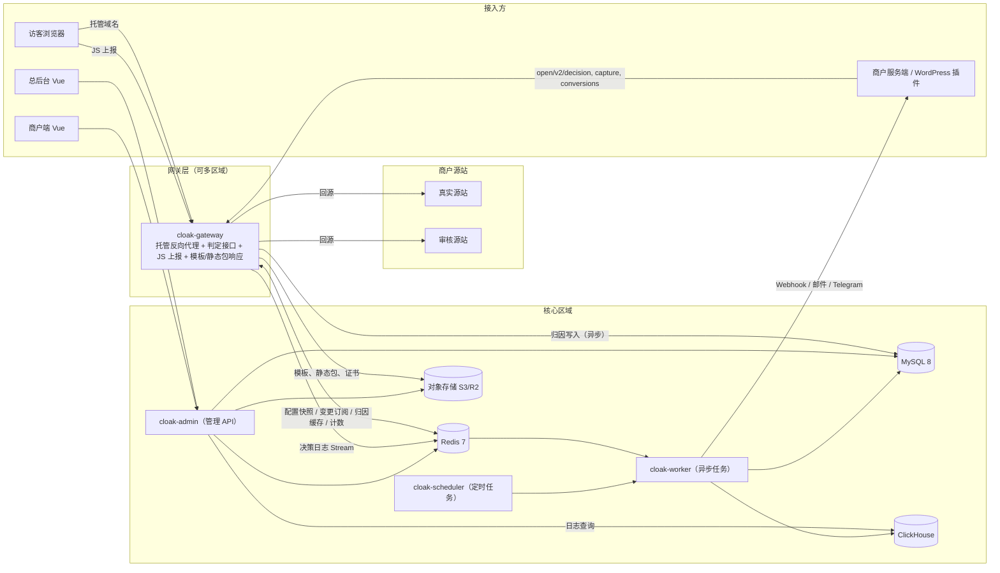
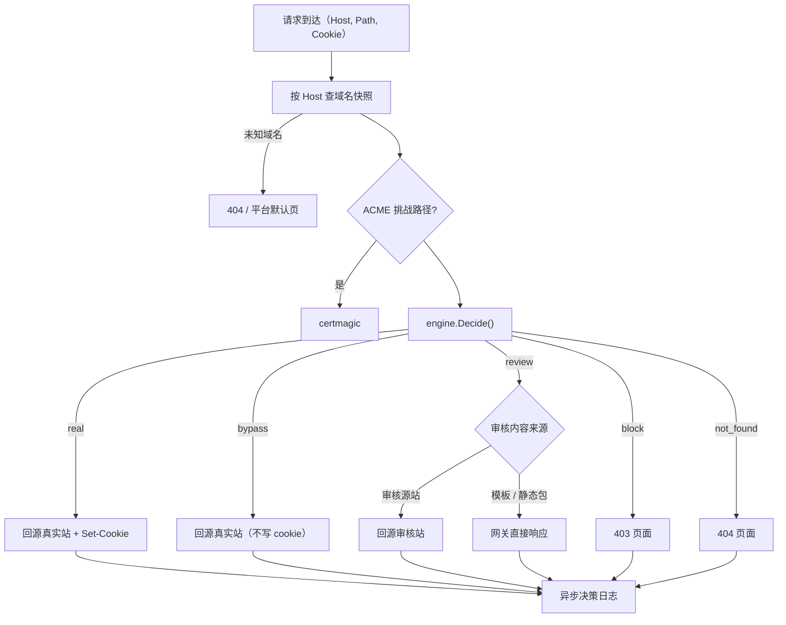
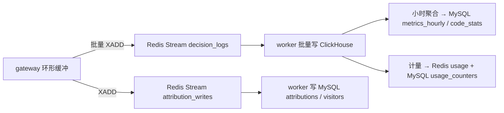

# 斗篷系统 V2 技术方案（Go）：归因放行网关

## 1. 目标与原则

对应 `docs/v2/prd-v2.md`。核心是：同一个 URL，按归因参数与访客 cookie 决定返回真实内容还是审核内容，不跳转。

设计原则：

- 判定热路径不查数据库：站点配置、参数字典、分销码、路径规则全部在网关内存快照中；访客放行靠签名令牌本地验签。
- 托管接入是反向代理，不是跳转；代理层要能承载正常网站流量（流式、长连接、WebSocket、大文件）。
- 一个引擎服务三种入口：托管代理、服务端判定接口、JS 上报。入口差异只在适配层。
- 配置版本化、变更推送、5 秒生效、可回滚。
- 判定、操作、调用全部可审计，带 `request_id`。
- 单仓库多二进制，先单区域部署，网关可平滑扩到多区域。

## 2. 总体架构



| 单元 | 职责 | 伸缩 |
| --- | --- | --- |
| `cloak-gateway` | 托管反向代理、判定接口 v2、V1 兼容接口、JS 上报、模板与静态包响应、证书签发 | 多节点多区域，无状态 |
| `cloak-admin` | 总后台与商户端管理 API、开放管理 API、报表查询、导出 | 多节点 |
| `cloak-worker` | 决策日志入库、归因落库、计量、聚合、DNS 校验、源站健康检查、告警、Webhook、静态包解压、导出 | 按队列伸缩 |
| `cloak-scheduler` | 定时巡检、聚合、清理、到期处理 | 单实例 + 锁 |

## 3. 技术选型

| 能力 | 选型 | 说明 |
| --- | --- | --- |
| 语言 | Go 1.23 | 标准库 `net/http`、`net/http/httputil` |
| HTTP 框架 | gin（管理 API、判定接口）；标准库 `http.Server` + 自定义 Handler（托管代理） | 代理路径避免框架开销 |
| 反向代理 | `httputil.ReverseProxy` + 自定义 `Transport` | 连接池、超时、重试、Location 改写、Set-Cookie 注入 |
| ORM | gorm（管理路径） | 网关只读快照，不走 ORM |
| 数据库 | MySQL 8 | 配置、分销码、归因、日志索引 |
| 缓存 | Redis 7 | 快照、变更订阅、归因缓存、计数、限流、防重放 |
| 队列 | Redis Streams（决策日志、归因写入）+ asynq（任务） | 日志高吞吐批消费 |
| 日志仓库 | ClickHouse | 决策日志、API 日志，按日分区 |
| 对象存储 | S3 兼容（R2 / MinIO） | 模板、静态包、导出、证书 |
| 证书 | certmagic | 托管域名按需 ACME，证书存对象存储或 Redis 共享 |
| IP 库 | GeoIP2 国家库 | 仅用于日志与报表中的国家；增强层再加 ASN/类型库 |
| UA 解析 | uasurfer | 设备类型、OS、浏览器，用于日志 |
| 配置 | viper + YAML + 环境变量 | |
| 日志 | zap | JSON，带 `request_id` |
| 迁移 | golang-migrate | |
| 观测 | Prometheus + OpenTelemetry | |
| 测试 | testify、miniredis、httptest、testcontainers | |
| 鉴权 | JWT（管理端，Redis 会话）+ HMAC（开放端）+ HMAC 访客令牌 | |
| 前端 | 现有 Vue 3 两套工程 | 不换栈 |

## 4. 代码结构

```text
backend-go/
  cmd/
    gateway/ admin/ worker/ scheduler/ migrate/
  internal/
    config/
    domain/                  # 领域模型与仓库接口
      merchant/ user/ rbac/ site/ domain/ origin/ reviewcontent/
      attribution/ promocode/ visitor/ conversion/ alert/ webhook/ quota/
    engine/                  # 判定引擎
      context.go             # RequestContext
      snapshot/              # 站点快照结构、加载、热更新
      pathrule/              # 路径规则匹配
      token/                 # 访客令牌签发与验签
      params/                # 归因参数提取、别名、格式校验
      codes/                 # 分销码/活动码校验
      decide.go              # Decide()：第 7.4 节顺序
      enhance/               # 可选增强层接口与实现（名单、审核机构、风险信号）
    proxy/                   # 托管反向代理
      handler.go             # Host 解析 → 判定 → 回源/模板
      transport.go           # 连接池、超时、重试
      rewrite.go             # 请求头/响应头改写、Set-Cookie 注入、Location 改写
      static.go              # 模板与静态包响应
      cache.go               # 可选静态资源缓存
      websocket.go
    attribution/             # 渠道识别、归因记录写入与缓存
    app/                     # 应用服务
      admin/ merchant/ open/ quota/ notify/ report/
    adapter/
      mysql/ redis/ clickhouse/ objectstore/ dns/ acme/ mailer/ telegram/ geoip/
    transport/http/
      admin/ open/ gateway/ middleware/ response/
    worker/
      streams/               # decision_logs、attribution_writes 消费
      tasks/                 # asynq 任务
    auth/ pkg/
  migrations/ configs/ deploy/ scripts/ docs/openapi/
```

`engine` 只依赖 `domain` 与快照结构，输入 `RequestContext` 与 `SiteSnapshot`，输出 `Decision`，可纯单测。

## 5. 判定引擎

### 5.1 请求上下文与决策结构

```go
type RequestContext struct {
    RequestID   string
    Entry       EntryType        // hosted, api_v2, api_v1, js
    Site        *SiteSnapshot
    Domain      *DomainSnapshot
    Method      string
    URL         *url.URL         // 访客看到的完整 URL
    CookieToken string           // 访客 cookie 原始值
    IP          netip.Addr
    UserAgent   string
    Referer     string
    AcceptLang  string
    Headers     http.Header      // 白名单头
    Now         time.Time
}

type Decision struct {
    Content          ContentKind   // real, review, block, not_found, bypass
    TouchType        TouchType     // first, return, none
    Attributed       bool
    Channel          string
    Code             *CodeRef      // 分销码/活动码
    MatchedParams    []string
    ValidationErrors []ParamError
    Visitor          VisitorToken  // 新签或续期后的令牌，空表示不写 cookie
    Attribution      *AttributionRef
    PathRule         *PathRuleRef
    Enhancement      *EnhancementOverride // 增强层覆盖原因
    Trace            []TraceStep
    Degraded         bool
}
```

### 5.2 判定顺序实现

```go
func (e *Engine) Decide(rc *RequestContext) Decision {
    if rule := e.pathRules.Match(rc.Site, rc.URL.Path); rule != nil && rule.Action != ActionEvaluate {
        return fromPathRule(rule)                         // bypass / always_real / always_review / block
    }
    tok, tokErr := e.token.Verify(rc.Site, rc.CookieToken, rc.Now)

    params := e.params.Extract(rc.Site, rc.URL.Query())   // 按字典与别名提取
    result := e.codes.Validate(rc.Site, params, rc.URL.Path, rc.Now) // 分销码/活动码/格式/来源校验

    var d Decision
    switch {
    case result.Attributed && result.Confidence >= rc.Site.MinConfidence:
        d = e.attributed(rc, tok, result)                 // first：签发或续期令牌，排队写归因，登记交接候选
    case tokErr == nil && tok.ExpiresAt.After(rc.Now):
        d = e.returning(rc, tok)                           // return：按 renew_mode 决定是否续期
    case e.handoff.ByToken(rc):                            // handoff：URL 带有效 _ck
        d = e.handoffByToken(rc)
    case rc.Site.HandoffMatch.Enabled && e.handoff.ByMatch(rc):   // handoff：跨浏览器交接匹配
        d = e.handoffByMatch(rc)
    default:
        d = e.unattributed(rc, result)                     // none：按 no_attribution_action
    }
    if rc.Site.Enhancements.Enabled() {
        d = e.enhance.Apply(rc, d)                         // 可选增强层覆盖
    }
    return d
}
```

性能预算：路径匹配 < 0.1ms，验签 < 0.1ms，参数提取与校验 < 0.5ms（分销码在内存哈希表），归因写入异步。整体判定 P99 ≤ 20ms 的主要余量留给增强层与 Redis 计数。

### 5.3 访客令牌

cookie 值格式：

```text
v1.<base64url(payload)>.<base64url(hmac_sha256(key, "v1." + payload_b64))>
payload = {"vid":"01J...","sid":123,"aid":456,"iat":1762000000,"exp":1764592000,"kv":3}
```

- `kv` 为密钥版本；站点维护当前密钥与宽限期内的旧密钥；轮换后旧令牌在宽限期内仍可验签，并在下一次放行时换发新令牌。
- 验签只需站点快照中的密钥，不访问 Redis。
- 续期：`renew_mode=sliding` 时每次放行重签 `exp`；`fixed` 时保持首访的 `exp`。
- cookie 属性：`HttpOnly; Secure; SameSite=Lax; Path=/; Domain=<站点配置>; Max-Age=<剩余秒数>`。
- 令牌总长度控制在 300 字节内。

### 5.4 归因参数与校验

- 参数字典编译为：`map[lowercase(name|alias)] -> ParamDef`。提取时遍历查询参数一次。
- `ParamDef`：类型（click/source/distributor/campaign/free）、格式（预编译正则、长度区间）、`sufficient`、状态。
- 分销码与活动码：站点快照内 `map[code] -> CodeDef`（状态、有效期、允许路径匹配器）。校验失败类型：`not_registered`、`disabled`、`expired`、`path_not_allowed`、`format_invalid`、`source_not_allowed`。
- 组合规则按站点配置，三选一：
  - `require_any`：任意一个 `sufficient` 且校验通过的参数即归因。
  - `require_click_or_code`：有效归因码或通过校验的点击参数即可归因；只有来源参数不归因。
  - `require_click_and_code`：必须同时有有效归因码（`Code != nil`）和通过校验的点击参数（`HasClick`）。只有点击参数、只有归因码、或来源参数加归因码，都不归因。此规则下参数的 `sufficient` 不再单独决定放行。
- 点击参数转发限制（可选）：Redis `INCR click:{site}:{hash(value)}` 带 TTL，超过阈值记为 `click_reused` 并按配置处理。

### 5.5 来源置信度

```go
type Confidence uint8 // Low=1, Medium=2, High=3

func (e *Engine) confidence(rc *RequestContext, r ValidationResult) Confidence {
    switch {
    case r.Code != nil:                                   // 登记校验通过的分销码/活动码
        return High
    case r.HasClickParam && (e.refererIsAdRedirect(rc.Referer) || e.ua.IsInAppBrowser(rc.UserAgent)):
        return High
    case r.HasClickParam && !e.clickReused(rc, r):        // 仅点击参数格式正确且未被转发复用
        return Medium
    case r.HasAllowedSource:                              // 仅 utm_source 在允许列表
        return Medium
    default:
        return Low
    }
}
```

- 广告跳转 Referer 域名表与内置浏览器 UA 特征表放在 `cfg:global`，总后台可维护，不需发版。
- 内置浏览器识别输出 `InAppBrowser{Name: "facebook"|"instagram"|"tiktok"|"line"|..., OS, OSMajor, DeviceFamily}`。
- 点击参数复用：`INCR click:{site}:{sha256(value)}` 带 TTL（默认 24h），同时 `SADD clickip:{site}:{hash} ip_prefix`；不同 IP 前缀数超过阈值（默认 3）记为 `click_reused`，置信度降为 Low。

### 5.6 跨浏览器交接

两条路径，先 token 后匹配。

**交接 token（确定）**

- 放行为 `first` 或 `return` 且 UA 为内置浏览器时，签发 `_ck` token：随机 16 字节，Redis `hot:{site}:{token_hash}` 存 `attribution_id`、`max_uses`（默认 3）、`expires_at`（默认 24h）。
- 网关在响应里给页面注入引导条（见 6.7）并提供 `handoffUrl = 当前 URL + _ck`；开启站内链接延续时，对 HTML 响应中的同域 `<a href>` 追加 `_ck`（流式 HTML 重写，只处理 `text/html`，不处理脚本生成的链接）。
- 新浏览器带 `_ck` 到达：`HINCRBY used`，未超次且未过期则读取 `attribution_id`，签发新访客令牌，`TouchType=handoff`，`HandoffKind=token`，响应时从 URL 中不移除 `_ck`（保持 URL 不变原则；token 失效后再访问同 URL 靠新 cookie 放行）。

**交接匹配（概率）**

- 放行为 `first` 且 UA 为内置浏览器时，登记候选：`ZADD hoc:{site}:{ip_hash}:{device_family} <now> <first_request_id|attribution_id>`，TTL = 窗口分钟数。
- 无参数、无 cookie、无 `_ck` 的请求：计算 `ip_hash` 与 `device_family`（OS + 大版本 + 机型族，如 `ios17-iphone`、`android14-samsung`），`ZRANGEBYSCORE` 取窗口内最近一条未消费候选；命中则 `ZREM`（同一首访只交接一次），签发新访客令牌，`TouchType=handoff`，`HandoffKind=match`，`Confidence=Low`。
- 只在候选来自内置浏览器时登记，系统浏览器之间不做匹配。
- 站点可配：开关、窗口分钟数、是否要求新请求 UA 为系统浏览器（默认要求，避免 WebView 内两个人互相匹配）。
- Redis 不可用时跳过匹配，不降级到其它近似。

**账号合并（事后）**

- `conversions` 带 `email_hash` 时，worker 查 `visitor_emails`，把不同访客的归因合并到首个有归因的访客，写 `attributions.merged_into_visitor_id`；报表按合并后统计，实时放行不受影响。

### 5.7 归因写入

- 放行为 `first` 时，网关把归因事件写入 Redis Stream `attribution_writes`，并把归因摘要写 `attr:{site}:{vid}` 缓存。
- worker 消费后 `INSERT ... ON DUPLICATE KEY UPDATE`：首次渠道、首次码只在新建时写，最近渠道、最近码、`last_touch_at`、`expires_at` 每次更新。
- `resolve` 与报表读 MySQL，详情页读缓存回填。
- 渠道推断顺序：分销码 > 活动码 > `utm_source` > 点击参数所属平台 > Referer 所属平台。

## 6. 托管反向代理

### 6.1 请求处理



### 6.2 回源细节

- 每个源站一个 `http.Transport`：`MaxIdleConnsPerHost` 按站点配置（默认 64）、`DialTimeout 5s`、`ResponseHeaderTimeout` 按站点（默认 15s）、`IdleConnTimeout 90s`、启用 HTTP keep-alive，不开启对源站的 HTTP/2 以简化行为。
- 请求改写：
  - `Host` 改为源站配置的回源 Host（默认源站 URL 的 host）。
  - 追加 `X-Forwarded-For`、`X-Forwarded-Proto`、`X-Forwarded-Host`、`X-Real-IP`。
  - 追加 `X-Cloak-Content: real|review`、`X-Cloak-Touch`、`X-Cloak-Visitor`、`X-Cloak-Request-Id`，供源站按需记录。
  - 删除客户端带来的 `X-Cloak-*` 头，防伪造。
  - 保留查询参数与请求体；`Content-Length` 与 `Transfer-Encoding` 由代理处理。
- 响应改写：
  - 放行且需写 cookie 时追加 `Set-Cookie`。
  - `Location` 以源站域名开头时改写为商户域名。
  - 删除 `Server`、`X-Powered-By`、`Via` 等；审核内容追加 `X-Robots-Tag: noindex`（可配）。
  - 不解压不改写响应体；`Content-Encoding` 原样透传。
  - 源站返回的 `Set-Cookie` 若带 `Domain=源站域名`，改写为商户域名或去掉 Domain。
- 流式：响应体通过 `io.Copy` 流式转发，`FlushInterval=-1` 支持 SSE。
- WebSocket：`Connection: Upgrade` 请求走 Hijack 双向拷贝，判定仍按 cookie 执行。
- 重试：仅对幂等方法且在连接建立失败或读响应头前失败时重试一次，换一个连接。
- 源站不可达：按站点 `fail_mode` 返回审核内容、维护页或真实站；记录 `origin_status=0`。
- 请求体大小上限按站点配置（默认 32MB），超限 413。
- 源站 IP 解析结果缓存 60s，支持源站为 IP 或域名。

### 6.3 模板与静态包

- 模板渲染：Go `html/template`，模板与变量在站点快照中，渲染结果按站点 + 模板版本缓存。
- 静态包：worker 解压到对象存储 `static/{site}/{version}/...`；网关按路径读取并本地磁盘缓存（LRU，可配容量）；路径不存在时返回 `entry` 文件（SPA 兼容）。
- 静态内容响应带 `Cache-Control: no-store`（默认，可改），避免 CDN 把审核内容缓存给放行访客。

### 6.4 可选静态资源缓存

- 按后缀与 `Cache-Control` 决定可缓存；缓存键包含 `content kind`，真实与审核分开。
- 存本地磁盘 + Redis 索引；默认关闭。

### 6.5 CDN 前置注意

- 前置 Cloudflare 等 CDN 时，必须把 HTML 设为不缓存或按 cookie 分片，否则审核内容可能被缓存给放行访客。接入指南给出推荐配置。
- 客户端真实 IP 从 `CF-Connecting-IP` 或 `X-Forwarded-For` 首个可信值取，受信任代理 CIDR 可配。

### 6.6 内置浏览器引导条与链接延续

- 仅对 `Content-Type: text/html` 且放行的响应处理；响应体若为 gzip/br 需先解压再重写，因此开启此功能的站点会向源站发送 `Accept-Encoding: identity`，由网关自己压缩后返回。
- 引导弹框不由网关内联 HTML。出现时机、关闭、重试、电脑与手机文案由 JS SDK 执行，见 `docs/v2/technical-design-handoff-prompt.md`。跳转仍是 iOS `x-safari-https://`、Android `intent://` 交给系统默认浏览器。
- 站内链接延续：流式 tokenizer 扫描 `<a href>`、`<form action>` 的同域相对/绝对链接追加 `_ck`；不处理 JS 动态生成的链接，接入指南说明可由 JS SDK 补齐。
- 以上两项默认只在 UA 为内置浏览器时生效，系统浏览器不注入。

### 6.7 证书

- certmagic 按需签发：收到未知证书的 Host 时，先查域名快照确认属于已绑定托管域名再允许签发，防止滥用。
- 证书存储：对象存储（多节点共享），本地缓存。
- 续期由 certmagic 自动处理；到期前 15/7/1 天告警。
- 可选前置 Cloudflare for SaaS，由其终止 TLS。

## 7. 配置快照与热更新

- 快照按站点组织：`SiteSnapshot` 含域名、源站、审核内容、路径规则（预编译）、参数字典（预编译）、分销码表、允许来源、cookie 与窗口配置、令牌密钥、增强层配置、额度状态。
- Redis `cfg:site:{site_id}` 存压缩 MsgPack；`host:{domain}` 存 `site_id`；`cfg:global` 存全局开关与内置字典。
- 管理 API 写操作后：重建对应站点快照 → 写 Redis → `PUBLISH cfg:changed site:{id}`。
- 网关启动：加载 `cfg:global` 与活跃站点列表；按 Host 首次访问时懒加载站点快照并常驻；订阅变更后增量替换，原子指针，无锁读。
- Redis 不可用：使用内存快照继续服务，新站点无法加载，告警。
- 快照带版本号；节点上报版本到 `gw:nodes:{node}`，总后台展示一致性。
- 分销码量大的站点（> 10 万）：快照只放码的哈希集合与状态位图，详情按需查 Redis Hash。

## 8. 服务端接入

### 8.1 判定接口 v2

```http
POST /api/open/v2/decision
X-Cloak-Key: <secret_prefix>
X-Cloak-Timestamp: 1762000000
X-Cloak-Nonce: 8f2c...
X-Cloak-Signature: hex(HMAC-SHA256(secret, timestamp + "\n" + nonce + "\n" + "POST" + "\n" + "/api/open/v2/decision" + "\n" + sha256(body)))
Content-Type: application/json

{
  "url": "https://shop.com/lp?ref=abc123&utm_source=facebook",
  "method": "GET",
  "visitorToken": "v1.eyJ...",
  "ip": "203.0.113.10",
  "userAgent": "...",
  "referer": "https://m.facebook.com/",
  "acceptLanguage": "en-US,en;q=0.9",
  "headers": {"Sec-CH-UA": "..."}
}
```

```json
{
  "code": 200,
  "msg": "ok",
  "data": {
    "requestId": "req_01J...",
    "content": "real",
    "touchType": "first",
    "attributed": true,
    "confidence": "high",
    "inAppBrowser": {"detected": true, "app": "facebook", "os": "ios", "deviceFamily": "ios17-iphone"},
    "handoffUrl": "https://shop.com/lp?ref=abc123&utm_source=facebook&_ck=9fK2...",
    "channel": "distributor:abc123",
    "code": {"id": 88, "code": "abc123", "type": "distributor", "name": "张三"},
    "matchedParams": ["ref", "utm_source"],
    "validationErrors": [],
    "visitorToken": "v1.eyJ...",
    "cookie": {"name": "_ck_vid", "value": "v1.eyJ...", "maxAge": 2592000,
               "domain": ".shop.com", "path": "/", "secure": true, "httpOnly": true, "sameSite": "Lax"},
    "attributionExpiresAt": "2026-12-03T15:00:00Z",
    "renderHint": null,
    "latencyMs": 3
  }
}
```

- 站点由密钥确定；`url` 的 host 必须在站点允许域名内。
- `content=review` 且站点审核内容为平台模板时，`renderHint` 返回 `{ "type": "html", "html": "..." }` 或 `{ "type": "url", "url": "..." }`。
- 签名时间窗 ±300s，nonce 5 分钟防重放，密钥可配 IP 白名单，限流按密钥与站点。
- V1 兼容：`POST /api/open/decision` + `X-API-Key`，内部映射到该 Key 的站点，返回体同时含 `page: review|real` 与上述字段。

### 8.2 其它开放接口

| 接口 | 作用 |
| --- | --- |
| `POST /api/open/v2/attribution/capture` | 只做归因写入与令牌签发，不返回内容判定 |
| `POST /api/open/v2/attribution/resolve` | 凭令牌或访客 ID 查归因 |
| `POST /api/open/v2/conversions` | 转化回传，幂等 |
| `GET/POST/PUT/DELETE /api/open/v2/promo-codes` | 分销码/活动码管理 |
| `GET /api/open/v2/decision-logs` | 决策日志分页 |
| `POST /api/open/v2/js/capture` | JS SDK 上报（公钥 + Origin 校验） |

### 8.3 WordPress 插件 v2 要点

- 在 `template_redirect` 优先级 1 执行；跳过 `is_admin`、REST、cron、登录用户（可配）、排除路径。
- 读取 cookie 与 `REQUEST_URI` 组装 `url`，调用判定接口，超时 3s，失败按兜底。
- 本地缓存：对同一访客令牌 + 路径的判定结果缓存 N 秒（transient），减少调用。
- `content=review`：按配置输出站内页面内容（`get_post` 渲染并 `exit`）、`readfile` 本地 HTML 或输出 `renderHint.html`，状态 200，`nocache_headers()`。
- `content=real`：`setcookie` 按返回指令写入后放行。
- WooCommerce：对 `is_cart()`、`is_checkout()`、`is_wc_endpoint_url('order-pay')` 启用；按商品/分类开关通过 `has_term`/商品 ID 判断。

## 9. 管理 API

- 协议：若依风格，`{code,msg,data}` 与 `{code,msg,rows,total}`，camelCase 字段；`/login`、`/getInfo`、`/getRouters`、`/logout` 路径不变。
- 门户：登录接收 `portal`，账号归属不符返回 403；JWT 含 `portal`，中间件校验路由前缀。
- 权限：路由声明权限标识，中间件校验；超级管理员 `*:*:*`。
- 前缀：`/api/admin/*`、`/api/merchant/*`、`/api/system/*`。
- 写操作统一经操作日志中间件，记录前后字段白名单摘要。
- 配置写操作在事务提交后触发快照重建与发布。

## 10. 日志管道



- 网关每 200ms 或 500 条刷一次；Redis 不可用时本地 WAL，恢复回放，超容量丢最旧。
- ClickHouse `decision_logs` 按日分区，排序键 `(merchant_id, site_id, created_at, request_id)`，常用筛选字段独立列，`matched_params`、`validation_errors`、`trace` 为 JSON 列。
- 分销码统计表 `code_stats_daily` 由聚合任务维护，列表页直接读。

## 11. 数据存储

### 11.1 MySQL 要点

- 所有商户数据表带 `merchant_id`，建 `(merchant_id, status)`、`(merchant_id, created_at)`。
- `sites.publishable_key` 唯一；`secret_prefix` 索引 + `secret_hash`（argon2id）。
- `domains.domain` 全局唯一。
- `promo_codes` 唯一键 `(site_id, code)`；索引 `(site_id, status, expires_at)`。
- `attribution_params` 内置行 `site_id = 0`，站点行覆盖同名内置行。
- `attributions` 唯一键 `(site_id, visitor_id)`；索引 `expires_at`、`(site_id, last_code_id)`。
- `conversions` 唯一键 `(merchant_id, order_no, status)`。
- `usage_counters` 唯一键 `(merchant_id, metric, period)`。
- `operation_logs`、`login_logs` 按月分区。

### 11.2 Redis Key

| Key | 类型 | 用途 | TTL |
| --- | --- | --- | --- |
| `cfg:global` | String | 全局开关、内置字典、默认路径规则 | 无 |
| `cfg:site:{site_id}` | String | 站点快照 | 无 |
| `host:{domain}` | String | 域名 → 站点 | 无 |
| `cfg:changed` | Pub/Sub | 变更通知 | - |
| `codes:{site_id}` | Hash | 大站点分销码详情 | 无 |
| `attr:{site_id}:{visitor_id}` | Hash | 归因摘要缓存 | 窗口 |
| `click:{site_id}:{hash}` | String | 点击参数复用计数 | 24h |
| `clickip:{site_id}:{hash}` | Set | 点击参数出现过的 IP 前缀 | 24h |
| `hot:{site_id}:{token_hash}` | Hash | 交接 token：归因 ID、次数、到期 | 24h |
| `hoc:{site_id}:{ip_hash}:{device_family}` | ZSet | 跨浏览器交接候选（内置浏览器首访） | 窗口分钟数 |
| `rl:{key_id}:{window}` | String | 限流 | 窗口 |
| `nonce:{key_id}:{nonce}` | String | 防重放 | 5 分钟 |
| `usage:{merchant_id}:{yyyymm}` | String | 当月判定计数 | 40 天 |
| `token:{jti}` | String | 管理端会话 | 有效期 |
| `gw:nodes:{node}` | Hash | 节点版本与心跳 | 60s |
| `stream:decision_logs`、`stream:attribution_writes` | Stream | 异步管道 | 按长度裁剪 |

### 11.3 ClickHouse

```sql
CREATE TABLE decision_logs (
  created_at DateTime64(3),
  request_id String,
  merchant_id UInt64, site_id UInt64, domain_id UInt64,
  entry LowCardinality(String), method LowCardinality(String), path String,
  query_param_names Array(String),
  touch_type LowCardinality(String), content LowCardinality(String), attributed UInt8,
  confidence LowCardinality(String),
  in_app_browser LowCardinality(String), device_family LowCardinality(String),
  handoff_kind LowCardinality(String), handoff_from_request_id String,
  channel LowCardinality(String), code_id UInt64, code String,
  matched_params Array(String), validation_errors String,
  visitor_id String, attribution_expires_at Nullable(DateTime),
  ip_hash String, ip_prefix String, country LowCardinality(String),
  device_type LowCardinality(String), os LowCardinality(String), browser LowCardinality(String),
  ua_summary String, referer_summary String,
  path_rule String, enhancement_override String,
  origin_kind LowCardinality(String), origin_status UInt16, origin_latency_ms UInt32,
  latency_ms UInt16, degraded UInt8,
  trace String
) ENGINE = MergeTree
PARTITION BY toDate(created_at)
ORDER BY (merchant_id, site_id, created_at, request_id)
TTL toDateTime(created_at) + INTERVAL 180 DAY;
```

## 12. 安全

- 密码 argon2id；服务端密钥随机 48 字节只展示一次；公钥可轮换。
- 访客令牌 HMAC-SHA256，密钥按站点独立，支持轮换与宽限。
- 开放接口 HMAC 签名、时间窗、nonce 防重放、密钥 IP 白名单、两级限流。
- 托管代理删除客户端伪造的 `X-Cloak-*` 与 `X-Forwarded-*`，按受信任代理列表重建。
- ACME 签发前校验域名归属，防止任意域名指向网关触发签发。
- 审核内容与模板响应 `X-Robots-Tag: noindex`；不暴露 `Server` 等特征头。
- 决策日志 IP 存 `sha256(ip+salt)` 与 `/24`（IPv6 `/48`）前缀；点击参数只存摘要。
- 管理端 JWT 2 小时 + Redis 会话可踢出；敏感操作可选二次验证。
- 导出链接签名且 24 小时过期。

## 13. 可观测性

- 指标：`gateway_decisions_total{entry,content,touch_type}`、`gateway_decision_latency_seconds`、`gateway_origin_requests_total{site,kind,status_class}`、`gateway_origin_latency_seconds`、`gateway_origin_errors_total`、`gateway_snapshot_version`、`gateway_wal_dropped_total`、`worker_stream_lag`、`clickhouse_insert_errors_total`、`webhook_delivery_total{status}`、`certs_expiring{days}`。
- 追踪：每次请求一个 span，子 span 为判定、回源、日志入队。
- 日志：JSON，带 `request_id`、`merchant_id`、`site_id`。
- 看板：网关 QPS/延迟/内容分布、回源错误率、Stream 积压、证书到期、节点快照一致性。

## 14. 部署

### 14.1 单区域

```text
Cloudflare / 负载均衡（TCP 直通或 TLS 终止）
  ├── *.商户托管域名、entry.cloak.example.com → gateway × 2+
  ├── api.cloak.example.com                   → admin × 2 + gateway（/api/open/*）
  ├── cloak.example.com                       → 总后台静态
  └── merchant.cloak.example.com              → 商户端静态
内网
  ├── MySQL 8 主从
  ├── Redis 7 哨兵/集群
  ├── ClickHouse 单机（后续双副本）
  ├── 对象存储（R2 / MinIO）
  ├── worker × N、scheduler × 1
  └── Prometheus + Grafana + Loki
```

- 网关对外直接承载 TLS（certmagic）或由 Cloudflare for SaaS 终止。
- 网关与源站之间走公网 HTTPS 或商户提供的内网/专线地址。
- 容器化；测试环境 Docker Compose，生产 Kubernetes 或 systemd。

### 14.2 多区域

- 网关多区域部署，GeoDNS 就近接入；每区域一套 Redis 副本承载快照、归因缓存、计数；归因写入与日志经本区域 Stream 由本区域 worker 写中心 MySQL/ClickHouse。
- 配置变更由中心 admin 发布到各区域 Redis。
- 证书存对象存储，各区域共享。

## 15. V1 → V2 迁移

| V1 | V2 | 规则 |
| --- | --- | --- |
| `merchants` | `merchants` | 直接迁移，去 `plan_type`，补额度与开关字段 |
| `users`、`roles`、`menus` | 同名 | 直接迁移，菜单重建 |
| `domains` | `sites` + `domains` | 每商户建默认站点；域名归入，`domain_type=hosted` |
| `cloaks` | `site_origins` + `site_review_contents` | 该域名最新启用斗篷：`white_url` → 审核源站，`realUrls[0]` → 真实源站；其余规则不迁移，记录到迁移报告供商户参考 |
| `api_keys` | 站点服务端密钥 | 每 Key 一个站点（服务端类型），`secret_hash` 原样，`ck_` 前缀继续认证；Key 规则不迁移 |
| `access_lists` | 增强层名单表 | 迁入但默认关闭 |
| 日志 | ClickHouse | 可选导入最近 30 天 |

`cmd/migrate` 支持 dry-run、按商户执行、输出迁移报告（含无法映射的规则与需要商户确认的源站）。

切换步骤：

1. 部署 V2，全量迁移，V1 继续服务。
2. 商户确认真实源站可被网关回源（源站若当前 CNAME 到 V1 入口，需先改为直接指向源站服务器）。
3. 开放接口按商户灰度转发到 V2（Nginx 按 Key 前缀或商户列表）。
4. 托管域名按商户灰度切到 V2 网关（改 DNS 或在 V1 入口反代到 V2）。
5. 两套前端改 `VITE_API_URL` 指向 V2 admin。
6. V1 停写，只读保留一个周期后下线。

## 16. 开发阶段

| 阶段 | 交付 |
| --- | --- |
| P0 工程基线 | 仓库结构、配置、日志、迁移框架、CI、统一响应与中间件、OpenAPI 骨架 |
| P1 管理域 | 账号权限、门户隔离、商户额度、站点与域名、源站与审核内容、参数字典、分销码、路径规则、操作日志；两套前端接入 |
| P2 引擎与托管 | 快照与热更新、访客令牌、参数提取与校验、判定顺序、反向代理、模板与静态包、证书、决策日志与归因写入管道、ClickHouse |
| P3 服务端接入 | 判定接口 v2、签名与限流、V1 兼容、WordPress/WooCommerce 插件 v2、JS SDK、转化回传 |
| P4 运营 | 看板、报表、分销码统计、告警、Webhook、自助工具、导出 |
| P5 迁移切换 | 迁移工具、影子对比、灰度、压测、多区域演练 |
| P6 增强层 | 名单、审核机构签名库、风险信号、地区与设备限制、支付链接联动 |

引擎单测覆盖：路径规则优先级、令牌验签与轮换、参数别名与格式、分销码各失败类型、组合规则、置信度计算、首访/回访/交接/无归因四种触点、交接 token 次数与过期、交接匹配窗口与一次性消费、续期模式、无归因动作、增强层覆盖。代理集成测试覆盖：头改写、Set-Cookie 注入、Location 改写、流式与 WebSocket、源站失败兜底。

## 17. 风险与对策

| 风险 | 对策 |
| --- | --- |
| 源站依赖客户端 IP 或 Host 做业务 | 透传 `X-Forwarded-*`、可配回源 Host；接入指南说明 |
| CDN 缓存把审核 HTML 给了放行访客 | 审核与模板响应 `no-store`；接入指南要求 HTML 不缓存或按 cookie 分片 |
| 大站点分销码过多导致快照膨胀 | 哈希集合 + Redis 详情按需查 |
| 令牌密钥泄露 | 站点级密钥、轮换与宽限、「强制重新归因」一键失效 |
| 源站慢导致网关连接堆积 | 每站点连接池上限、超时、熔断后走兜底 |
| ACME 速率限制 | 签发前 DNS 预检、失败退避、可选 Cloudflare for SaaS |
| 点击参数格式变化 | 内置字典可在总后台调整，不需发版 |
| 交接匹配在运营商 NAT 下误放 | 只匹配内置浏览器首访、同设备族、一次性消费、短窗口；站点可关闭 |
| HTML 重写影响页面 | 只在内置浏览器 UA 下重写；引导条内联无外部依赖；链接延续默认关闭 |
